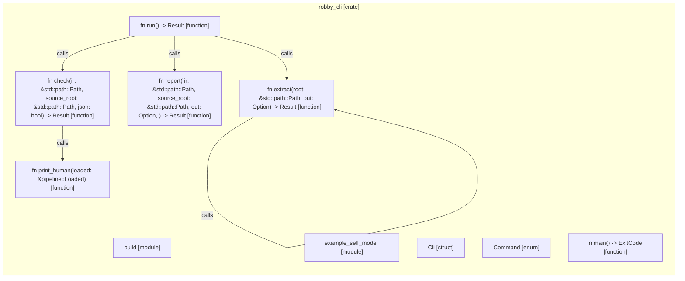

# `robby_cli`

[Self-model](../README.md)

| | |
|---|---|
| kind | `code.crate` |
| provenance | extractor · confidence 1.00 |
| nodes | 41 |

## Modules

- [`build`](build/index.md) — 5 nodes
- [`example_self_model`](example_self_model/index.md) — 15 nodes

## Items

| Item | Kind | Steps | Location |
|---|---|---:|---|
| [`Cli`](cli.md) | `code.struct` | — | `crates/robby-cli/src/main.rs:14:1` |
| [`Command`](command.md) | `code.enum` | — | `crates/robby-cli/src/main.rs:25:1` |
| [`main`](main.md) | `code.function` | 3 | `crates/robby-cli/src/main.rs:73:1` |
| [`run`](run.md) | `code.function` | 18 | `crates/robby-cli/src/main.rs:83:1` |
| [`check`](check.md) | `code.function` | 6 | `crates/robby-cli/src/main.rs:120:1` |
| [`print_human`](print-human.md) | `code.function` | 12 | `crates/robby-cli/src/main.rs:141:1` |
| [`extract`](extract.md) | `code.function` | 11 | `crates/robby-cli/src/main.rs:182:1` |
| [`report`](report.md) | `code.function` | 7 | `crates/robby-cli/src/main.rs:203:1` |

## Imports

- `use std::path::PathBuf;`
- `use std::process::ExitCode;`
- `use anyhow::Result;`
- `use clap::{Parser, Subcommand};`
- `use robby_ir::Severity;`
- `use robby_render::pipeline;`

