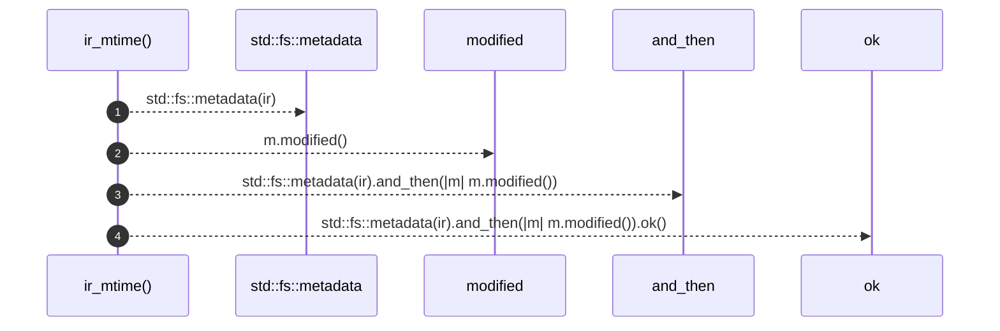

# `robby_cli::ir_mtime`

[Self-model](../README.md) · [robby_cli](index.md)

| | |
|---|---|
| kind | `code.function` |
| signature | `fn ir_mtime(ir: &std::path::Path) -> Option<std::time::SystemTime>` |
| location | [`crates/robby-cli/src/main.rs:274`](../../../crates/robby-cli/src/main.rs#L274) |
| provenance | extractor · confidence 1.00 |

```rust
fn ir_mtime(ir: &std::path::Path) -> Option<std::time::SystemTime> {
    std::fs::metadata(ir).and_then(|m| m.modified()).ok()
}
```



4 steps · 0 observed · 4 possible only

## Referenced by

- calls ← [`robby_cli::web`](web.md)

