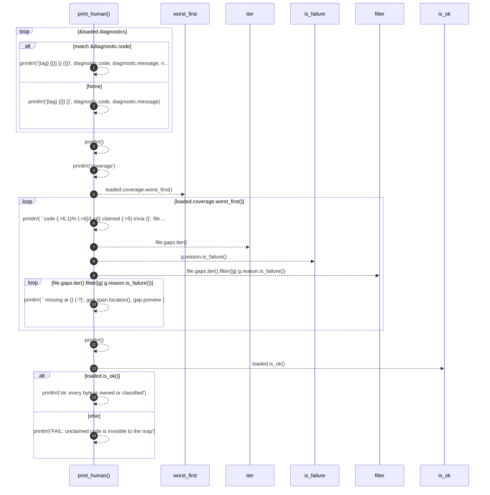

# `robby_cli::print_human`

[Self-model](../README.md) · [robby_cli](index.md)

| | |
|---|---|
| kind | `code.function` |
| signature | `fn print_human(loaded: &pipeline::Loaded)` |
| location | [`crates/robby-cli/src/main.rs:282`](../../../crates/robby-cli/src/main.rs#L282) |
| provenance | extractor · confidence 1.00 |

```rust
fn print_human(loaded: &pipeline::Loaded) {
    for diagnostic in &loaded.diagnostics {
        let tag = match diagnostic.severity {
            Severity::Error => "error",
            Severity::Warning => "warn ",
            Severity::Info => "info ",
        };
        match &diagnostic.node {
            Some(node) => println!("{tag} [{}] {} ({})", diagnostic.code, diagnostic.message, node),
            None => println!("{tag} [{}] {}", diagnostic.code, diagnostic.message),
        }
    }

    println!();
    println!("coverage");
    for file in loaded.coverage.worst_first() {
        println!(
            "  code {:>6.1}%  {:>6}/{:<6} claimed  {:>5} trivia  {}",
            file.code_ratio() * 100.0,
            file.covered_bytes,
            file.covered_bytes + file.uncovered_bytes(),
            file.trivia_bytes(),
            file.file
        );
        for gap in file.gaps.iter().filter(|g| g.reason.is_failure()) {
            println!(
                "           missing at {}  {:?}",
                gap.span.location(),
                gap.preview
            );
        }
    }

    println!();
    if loaded.is_ok() {
        println!("ok: every byte is owned or classified");
    } else {
        println!("FAIL: unclaimed code is invisible to the map");
    }
}
```



14 steps · 0 observed · 14 possible only

**Edges**

- calls → [`robby_ir::coverage::impl CoverageReport::worst_first`](../robby_ir/coverage/index.md)
- calls → [`robby_ir::coverage::impl GapReason::is_failure`](../robby_ir/coverage/index.md)
- calls → [`robby_render::pipeline::impl Loaded::is_ok`](../robby_render/pipeline/index.md)

## References

- calls → [`robby_ir::coverage`](../robby_ir/coverage/index.md) — is_failure, worst_first
- calls → [`robby_render::pipeline`](../robby_render/pipeline/index.md) — is_ok

## Referenced by

- calls ← [`robby_cli::check`](check.md)

