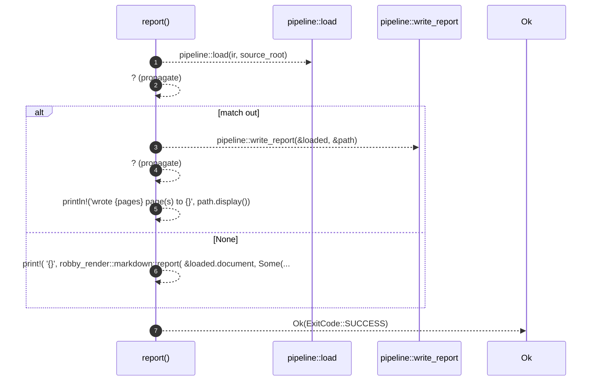

# `robby_cli::report`

[Self-model](../README.md) · [robby_cli](index.md)

| | |
|---|---|
| kind | `code.function` |
| signature | `fn report(     ir: &std::path::Path,     source_root: &std::path::Path,     out: Option<PathBuf>, ) -> Result<ExitCode>` |
| location | [`crates/robby-cli/src/main.rs:203`](../../../crates/robby-cli/src/main.rs#L203) |
| provenance | extractor · confidence 1.00 |

```rust
fn report(
    ir: &std::path::Path,
    source_root: &std::path::Path,
    out: Option<PathBuf>,
) -> Result<ExitCode> {
    let loaded = pipeline::load(ir, source_root)?;
    match out {
        Some(path) => {
            let pages = pipeline::write_report(&loaded, &path)?;
            println!("wrote {pages} page(s) to {}", path.display());
        }
        None => print!(
            "{}",
            robby_render::markdown::report(
                &loaded.document,
                Some(&loaded.coverage),
                Some(&loaded.sources)
            )
        ),
    }
    Ok(ExitCode::SUCCESS)
}
```



7 steps · 0 observed · 7 possible only

**Edges**

- calls → [`robby_render::pipeline::load`](../robby_render/pipeline/load.md)
- calls → [`robby_render::pipeline::write_report`](../robby_render/pipeline/write-report.md)

