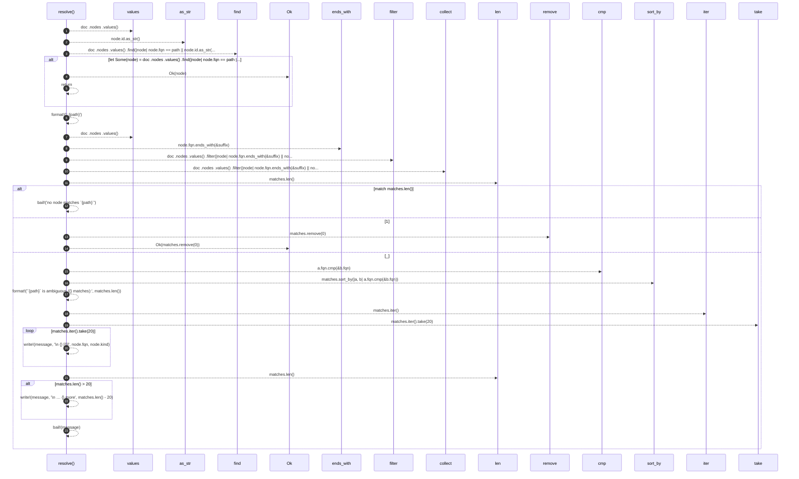

# `robby_cli::resolve`

[Self-model](../README.md) · [robby_cli](index.md)

| | |
|---|---|
| kind | `code.function` |
| signature | `fn resolve<'a>(doc: &'a Document, path: &str) -> Result<&'a Node>` |
| location | [`crates/robby-cli/src/main.rs:460`](../../../crates/robby-cli/src/main.rs#L460) |
| provenance | extractor · confidence 1.00 |

> Resolve an exact fqn, an id, or a unique suffix / bare name.

```rust
/// Resolve an exact fqn, an id, or a unique suffix / bare name.
fn resolve<'a>(doc: &'a Document, path: &str) -> Result<&'a Node> {
    if let Some(node) = doc
        .nodes
        .values()
        .find(|node| node.fqn == path || node.id.as_str() == path)
    {
        return Ok(node);
    }

    let suffix = format!("::{path}");
    let mut matches: Vec<&Node> = doc
        .nodes
        .values()
        .filter(|node| node.fqn.ends_with(&suffix) || node.name == path)
        .collect();

    match matches.len() {
        0 => bail!("no node matches `{path}`"),
        1 => Ok(matches.remove(0)),
        _ => {
            matches.sort_by(|a, b| a.fqn.cmp(&b.fqn));
            let mut message = format!("`{path}` is ambiguous ({} matches):", matches.len());
            for node in matches.iter().take(20) {
                let _ = write!(message, "\n  {}  [{}]", node.fqn, node.kind);
            }
            if matches.len() > 20 {
                let _ = write!(message, "\n  … {} more", matches.len() - 20);
            }
            bail!(message)
        }
    }
}
```



23 steps · 0 observed · 23 possible only

**Edges**

- calls → [`robby_ir::kind::impl Kind::as_str`](../robby_ir/kind/index.md)
- calls → [`robby_render::view::select::collect`](../robby_render/view/select/collect.md)

## References

- calls → [`robby_ir::kind`](../robby_ir/kind/index.md) — as_str
- calls → [`robby_render::view::select`](../robby_render/view/select/index.md) — collect

## Referenced by

- calls ← [`robby_cli::show`](show.md)

