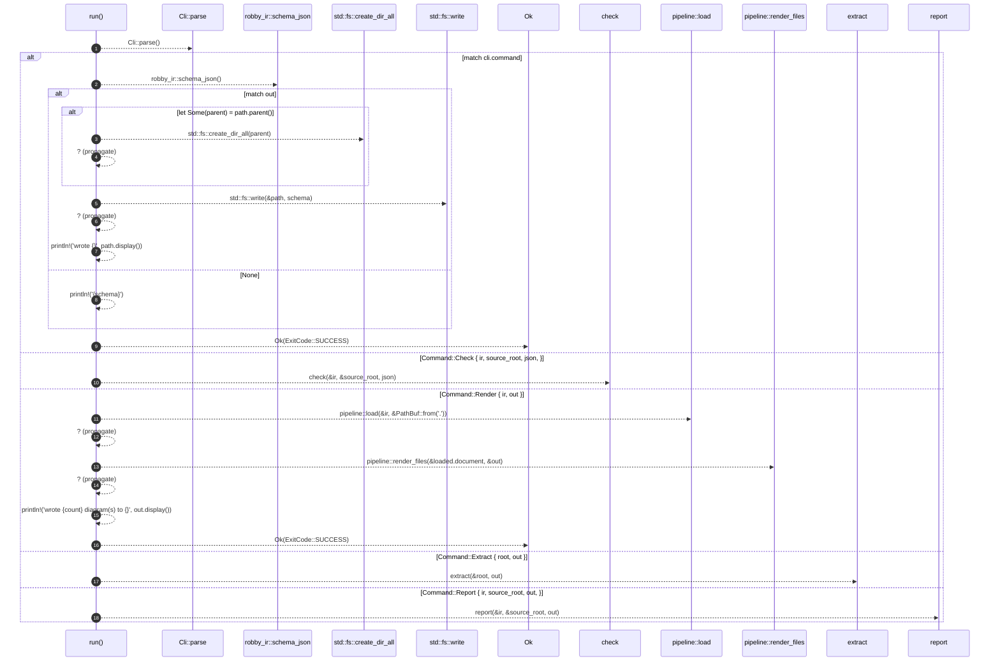

# `robby_cli::run`

[Self-model](../README.md) · [robby_cli](index.md)

| | |
|---|---|
| kind | `code.function` |
| signature | `fn run() -> Result<ExitCode>` |
| location | [`crates/robby-cli/src/main.rs:83`](../../../crates/robby-cli/src/main.rs#L83) |
| provenance | extractor · confidence 1.00 |

```rust
fn run() -> Result<ExitCode> {
    let cli = Cli::parse();
    match cli.command {
        Command::Schema { out } => {
            let schema = robby_ir::schema_json();
            match out {
                Some(path) => {
                    if let Some(parent) = path.parent() {
                        std::fs::create_dir_all(parent)?;
                    }
                    std::fs::write(&path, schema)?;
                    println!("wrote {}", path.display());
                }
                None => println!("{schema}"),
            }
            Ok(ExitCode::SUCCESS)
        }
        Command::Check {
            ir,
            source_root,
            json,
        } => check(&ir, &source_root, json),
        Command::Render { ir, out } => {
            let loaded = pipeline::load(&ir, &PathBuf::from("."))?;
            let count = pipeline::render_files(&loaded.document, &out)?;
            println!("wrote {count} diagram(s) to {}", out.display());
            Ok(ExitCode::SUCCESS)
        }
        Command::Extract { root, out } => extract(&root, out),
        Command::Report {
            ir,
            source_root,
            out,
        } => report(&ir, &source_root, out),
    }
}
```



18 steps · 0 observed · 18 possible only

**Edges**

- calls → [`robby_ir::schema_json`](../robby_ir/schema-json.md)
- calls → [`robby_cli::check`](check.md)
- calls → [`robby_render::pipeline::load`](../robby_render/pipeline/load.md)
- calls → [`robby_render::pipeline::render_files`](../robby_render/pipeline/render-files.md)
- calls → [`robby_cli::extract`](extract.md)
- calls → [`robby_cli::report`](report.md)

