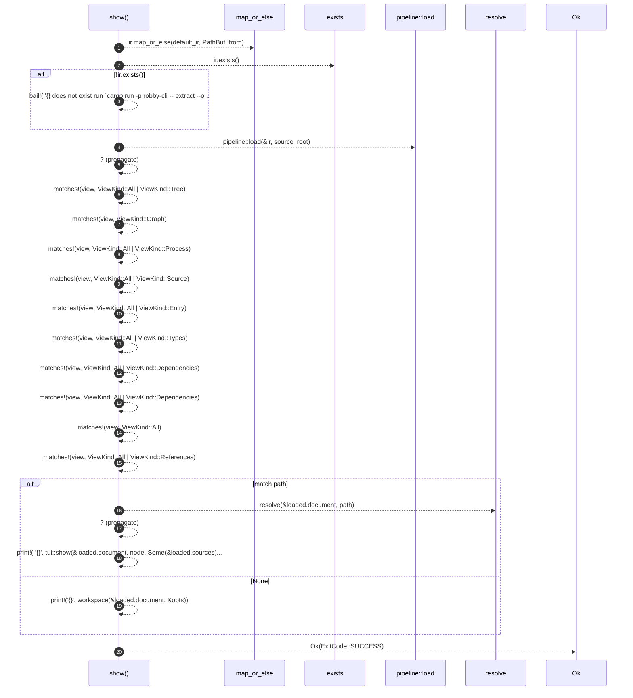

# `robby_cli::show`

[Self-model](../README.md) · [robby_cli](index.md)

| | |
|---|---|
| kind | `code.function` |
| signature | `fn show(     path: Option<&str>,     ir: Option<&std::path::Path>,     source_root: &std::path::Path,     depth: usize,     width: usize,     all: bool,     view: ViewKind,     no_source: bool, ) -> Result<ExitCode>` |
| location | [`crates/robby-cli/src/main.rs:386`](../../../crates/robby-cli/src/main.rs#L386) |
| provenance | extractor · confidence 1.00 |

```rust
#[allow(clippy::too_many_arguments)]
fn show(
    path: Option<&str>,
    ir: Option<&std::path::Path>,
    source_root: &std::path::Path,
    depth: usize,
    width: usize,
    all: bool,
    view: ViewKind,
    no_source: bool,
) -> Result<ExitCode> {
    let ir = ir.map_or_else(default_ir, PathBuf::from);
    if !ir.exists() {
        bail!(
            "{} does not exist; run `cargo run -p robby-cli -- extract --out {}` first",
            ir.display(),
            ir.display()
        );
    }

    let loaded = pipeline::load(&ir, source_root)?;
    let opts = tui::ShowOptions {
        depth,
        width,
        all,
        tree: matches!(view, ViewKind::All | ViewKind::Tree),
        graph: matches!(view, ViewKind::Graph),
        process: matches!(view, ViewKind::All | ViewKind::Process),
        source: !no_source && matches!(view, ViewKind::All | ViewKind::Source),
        entry: matches!(view, ViewKind::All | ViewKind::Entry),
        types: matches!(view, ViewKind::All | ViewKind::Types),
        dependencies: matches!(view, ViewKind::All | ViewKind::Dependencies),
        externals: matches!(view, ViewKind::All | ViewKind::Dependencies),
        comments: matches!(view, ViewKind::All),
        references: matches!(view, ViewKind::All | ViewKind::References),
    };

    match path {
        Some(path) => {
            let node = resolve(&loaded.document, path)?;
            print!(
                "{}",
                tui::show(&loaded.document, node, Some(&loaded.sources), &opts)
            );
        }
        None => print!("{}", workspace(&loaded.document, &opts)),
    }

    Ok(ExitCode::SUCCESS)
}
```



20 steps · 0 observed · 20 possible only

**Edges**

- calls → [`robby_render::pipeline::load`](../robby_render/pipeline/load.md)
- calls → [`robby_cli::resolve`](resolve.md)

## References

- calls → [`robby_cli`](index.md) — resolve
- calls → [`robby_render::pipeline`](../robby_render/pipeline/index.md) — load

## Referenced by

- calls ← [`robby_cli::run`](run.md)

