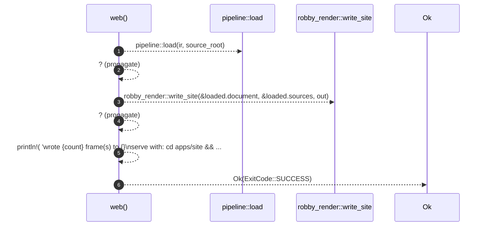

# `robby_cli::web`

[Self-model](../README.md) · [robby_cli](index.md)

| | |
|---|---|
| kind | `code.function` |
| signature | `fn web(ir: &std::path::Path, source_root: &std::path::Path, out: &std::path::Path) -> Result<ExitCode>` |
| location | [`crates/robby-cli/src/main.rs:222`](../../../crates/robby-cli/src/main.rs#L222) |
| provenance | extractor · confidence 1.00 |

```rust
fn web(ir: &std::path::Path, source_root: &std::path::Path, out: &std::path::Path) -> Result<ExitCode> {
    let loaded = pipeline::load(ir, source_root)?;
    let count = robby_render::write_site(&loaded.document, &loaded.sources, out)?;
    println!(
        "wrote {count} frame(s) to {}\nserve with: cd apps/site && npm install && npm run dev",
        out.display()
    );
    Ok(ExitCode::SUCCESS)
}
```



6 steps · 0 observed · 6 possible only

**Edges**

- calls → [`robby_render::pipeline::load`](../robby_render/pipeline/load.md)
- calls → [`robby_render::web::write_site`](../robby_render/web/write-site.md)

## References

- calls → [`robby_render::pipeline`](../robby_render/pipeline/index.md) — load
- calls → [`robby_render::web`](../robby_render/web/index.md) — write_site

## Referenced by

- calls ← [`robby_cli::run`](run.md)

