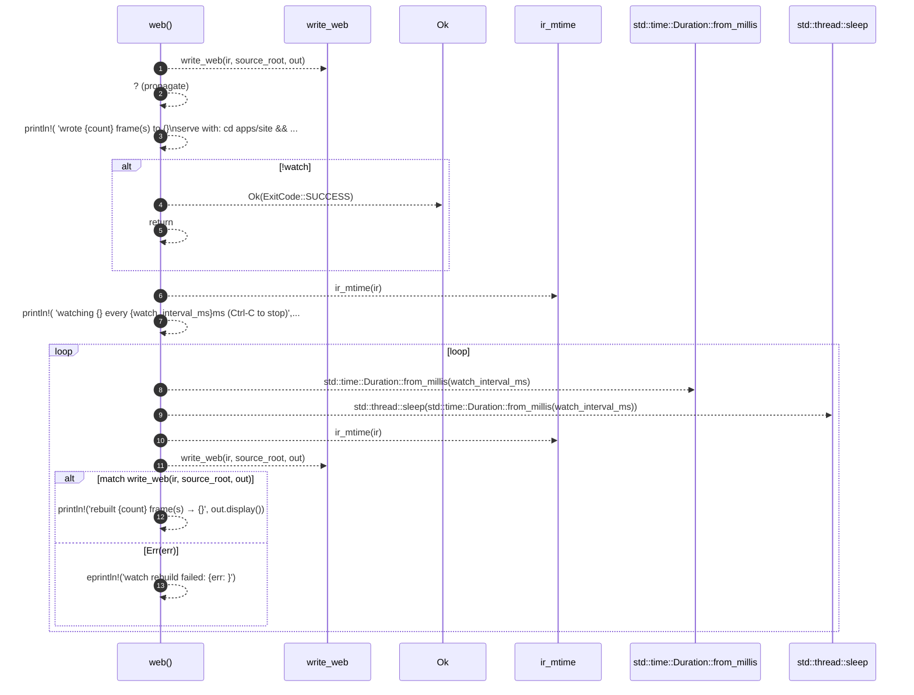

# `robby_cli::web`

[Self-model](../README.md) · [robby_cli](index.md)

| | |
|---|---|
| kind | `code.function` |
| signature | `fn web(     ir: &std::path::Path,     source_root: &std::path::Path,     out: &std::path::Path,     watch: bool,     watch_interval_ms: u64, ) -> Result<ExitCode>` |
| location | [`crates/robby-cli/src/main.rs:230`](../../../crates/robby-cli/src/main.rs#L230) |
| provenance | extractor · confidence 1.00 |

```rust
fn web(
    ir: &std::path::Path,
    source_root: &std::path::Path,
    out: &std::path::Path,
    watch: bool,
    watch_interval_ms: u64,
) -> Result<ExitCode> {
    let count = write_web(ir, source_root, out)?;
    println!(
        "wrote {count} frame(s) to {}\nserve with: cd apps/site && npm install && npm run dev",
        out.display()
    );
    if !watch {
        return Ok(ExitCode::SUCCESS);
    }

    let mut last_mtime = ir_mtime(ir);
    println!(
        "watching {} every {watch_interval_ms}ms (Ctrl-C to stop)",
        ir.display()
    );
    loop {
        std::thread::sleep(std::time::Duration::from_millis(watch_interval_ms));
        let mtime = ir_mtime(ir);
        if mtime == last_mtime {
            continue;
        }
        last_mtime = mtime;
        match write_web(ir, source_root, out) {
            Ok(count) => println!("rebuilt {count} frame(s) → {}", out.display()),
            Err(err) => eprintln!("watch rebuild failed: {err:#}"),
        }
    }
}
```



13 steps · 0 observed · 13 possible only

**Edges**

- calls → [`robby_cli::write_web`](write-web.md)
- calls → [`robby_cli::ir_mtime`](ir-mtime.md)
- calls → [`robby_cli::ir_mtime`](ir-mtime.md)
- calls → [`robby_cli::write_web`](write-web.md)

## References

- calls → [`robby_cli`](index.md) — ir_mtime, write_web

## Referenced by

- calls ← [`robby_cli::run`](run.md)

