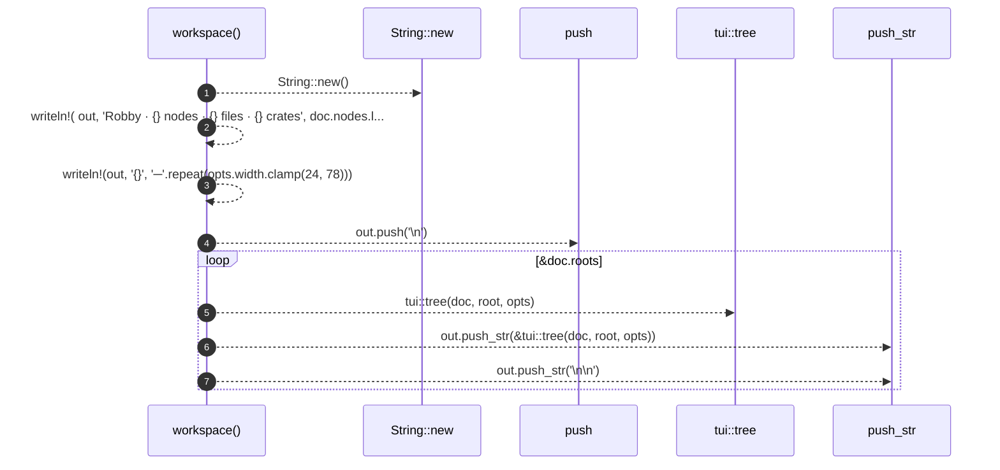

# `robby_cli::workspace`

[Self-model](../README.md) · [robby_cli](index.md)

| | |
|---|---|
| kind | `code.function` |
| signature | `fn workspace(doc: &Document, opts: &tui::ShowOptions) -> String` |
| location | [`crates/robby-cli/src/main.rs:468`](../../../crates/robby-cli/src/main.rs#L468) |
| provenance | extractor · confidence 1.00 |

```rust
fn workspace(doc: &Document, opts: &tui::ShowOptions) -> String {
    let mut out = String::new();
    let _ = writeln!(
        out,
        "Robby · {} nodes · {} files · {} crates",
        doc.nodes.len(),
        doc.files.len(),
        doc.roots.len()
    );
    let _ = writeln!(out, "{}", "─".repeat(opts.width.clamp(24, 78)));
    out.push('\n');

    for root in &doc.roots {
        out.push_str(&tui::tree(doc, root, opts));
        out.push_str("\n\n");
    }
    out
}
```



7 steps · 0 observed · 7 possible only

**Edges**

- calls → [`robby_ir::kind::impl Kind::new`](../robby_ir/kind/index.md)
- calls → [`robby_render::report::impl Report::push`](../robby_render/report/index.md)
- calls → [`robby_render::tui::tree`](../robby_render/tui/tree.md)

## References

- calls → [`robby_ir::kind`](../robby_ir/kind/index.md) — new
- calls → [`robby_render::report`](../robby_render/report/index.md) — push
- calls → [`robby_render::tui`](../robby_render/tui/index.md) — tree

