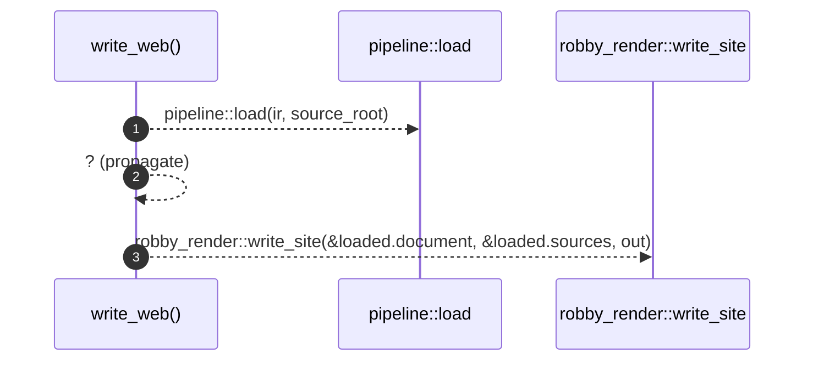

# `robby_cli::write_web`

[Self-model](../README.md) · [robby_cli](index.md)

| | |
|---|---|
| kind | `code.function` |
| signature | `fn write_web(     ir: &std::path::Path,     source_root: &std::path::Path,     out: &std::path::Path, ) -> Result<usize>` |
| location | [`crates/robby-cli/src/main.rs:265`](../../../crates/robby-cli/src/main.rs#L265) |
| provenance | extractor · confidence 1.00 |

```rust
fn write_web(
    ir: &std::path::Path,
    source_root: &std::path::Path,
    out: &std::path::Path,
) -> Result<usize> {
    let loaded = pipeline::load(ir, source_root)?;
    robby_render::write_site(&loaded.document, &loaded.sources, out)
}
```



3 steps · 0 observed · 3 possible only

**Edges**

- calls → [`robby_render::pipeline::load`](../robby_render/pipeline/load.md)
- calls → [`robby_render::web::write_site`](../robby_render/web/write-site.md)

## References

- calls → [`robby_render::pipeline`](../robby_render/pipeline/index.md) — load
- calls → [`robby_render::web`](../robby_render/web/index.md) — write_site

## Referenced by

- calls ← [`robby_cli::web`](web.md)

