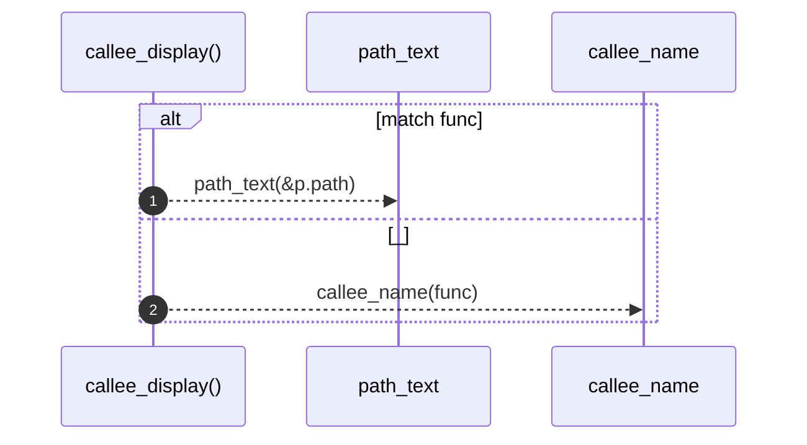

# `robby_extract::callee_display`

[Self-model](../README.md) · [robby_extract](index.md)

| | |
|---|---|
| kind | `code.function` |
| signature | `fn callee_display(func: &Expr) -> String` |
| location | [`crates/robby-extract/src/lib.rs:759`](../../../crates/robby-extract/src/lib.rs#L759) |
| provenance | extractor · confidence 1.00 |

> The readable callee, including its module path: `Document::new`.

```rust
/// The readable callee, including its module path: `Document::new`.
fn callee_display(func: &Expr) -> String {
    match func {
        Expr::Path(p) => path_text(&p.path),
        _ => callee_name(func),
    }
}
```



2 steps · 0 observed · 2 possible only

**Edges**

- calls → [`robby_extract::path_text`](path-text.md)
- calls → [`robby_extract::callee_name`](callee-name.md)

