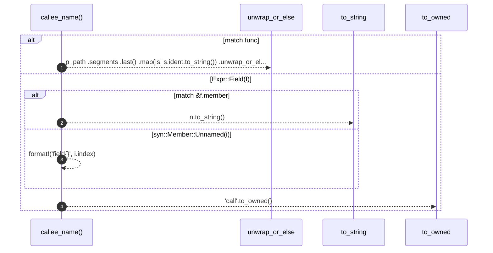

# `robby_extract::callee_name`

[Self-model](../README.md) · [robby_extract](index.md)

| | |
|---|---|
| kind | `code.function` |
| signature | `fn callee_name(func: &Expr) -> String` |
| location | [`crates/robby-extract/src/lib.rs:767`](../../../crates/robby-extract/src/lib.rs#L767) |
| provenance | extractor · confidence 1.00 |

> The last segment, used to match against known items.

```rust
/// The last segment, used to match against known items.
fn callee_name(func: &Expr) -> String {
    match func {
        Expr::Path(p) => p
            .path
            .segments
            .last()
            .map(|s| s.ident.to_string())
            .unwrap_or_else(|| "call".to_owned()),
        Expr::Field(f) => match &f.member {
            syn::Member::Named(n) => n.to_string(),
            syn::Member::Unnamed(i) => format!("field{}", i.index),
        },
        _ => "call".to_owned(),
    }
}
```



4 steps · 0 observed · 4 possible only

