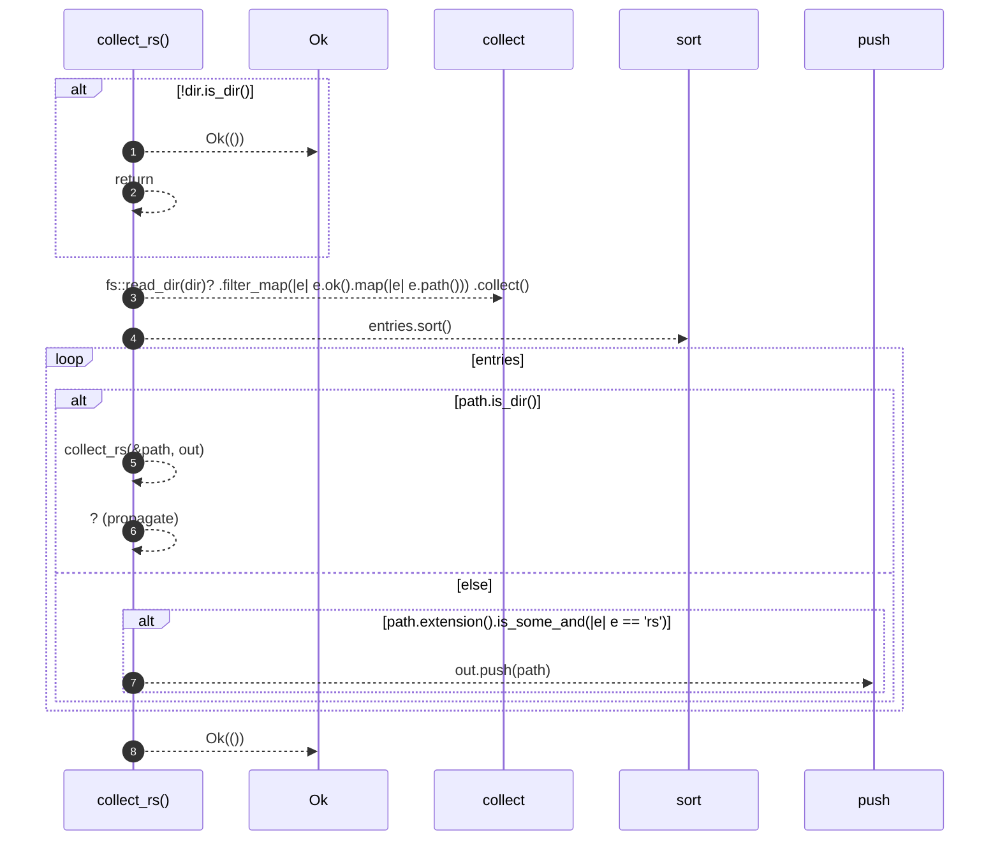

# `robby_extract::collect_rs`

[Self-model](../README.md) · [robby_extract](index.md)

| | |
|---|---|
| kind | `code.function` |
| signature | `fn collect_rs(dir: &Path, out: &mut Vec<PathBuf>) -> Result<()>` |
| location | [`crates/robby-extract/src/lib.rs:99`](../../../crates/robby-extract/src/lib.rs#L99) |
| provenance | extractor · confidence 1.00 |

```rust
fn collect_rs(dir: &Path, out: &mut Vec<PathBuf>) -> Result<()> {
    if !dir.is_dir() {
        return Ok(());
    }
    let mut entries: Vec<PathBuf> = fs::read_dir(dir)?
        .filter_map(|e| e.ok().map(|e| e.path()))
        .collect();
    entries.sort();
    for path in entries {
        if path.is_dir() {
            collect_rs(&path, out)?;
        } else if path.extension().is_some_and(|e| e == "rs") {
            out.push(path);
        }
    }
    Ok(())
}
```



8 steps · 0 observed · 8 possible only

**Edges**

- calls → [`robby_extract::collect_rs`](collect-rs.md)

