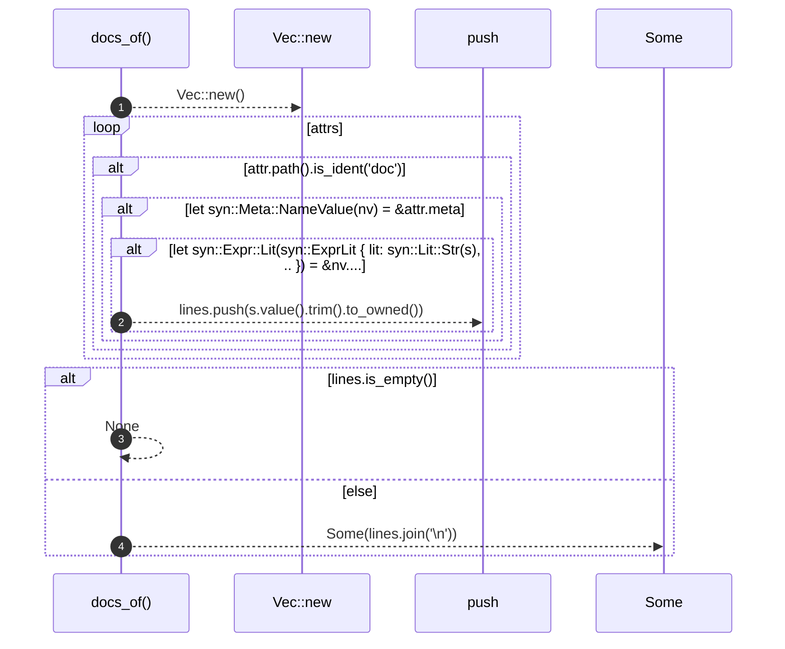

# `robby_extract::docs_of`

[Self-model](../README.md) · [robby_extract](index.md)

| | |
|---|---|
| kind | `code.function` |
| signature | `fn docs_of<T: Spanned>(_t: &T, attrs: &[syn::Attribute]) -> Option<String>` |
| location | [`crates/robby-extract/src/lib.rs:398`](../../../crates/robby-extract/src/lib.rs#L398) |
| provenance | extractor · confidence 1.00 |

```rust
fn docs_of<T: Spanned>(_t: &T, attrs: &[syn::Attribute]) -> Option<String> {
    let mut lines = Vec::new();
    for attr in attrs {
        if attr.path().is_ident("doc") {
            if let syn::Meta::NameValue(nv) = &attr.meta {
                if let syn::Expr::Lit(syn::ExprLit {
                    lit: syn::Lit::Str(s),
                    ..
                }) = &nv.value
                {
                    lines.push(s.value().trim().to_owned());
                }
            }
        }
    }
    if lines.is_empty() {
        None
    } else {
        Some(lines.join("\n"))
    }
}
```



4 steps · 0 observed · 4 possible only

**Edges**

- calls → [`robby_extract::impl LineIndex::new`](index.md)

