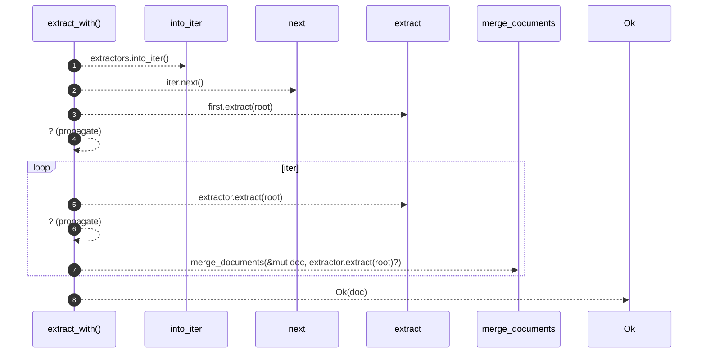

# `robby_extract::extract_with`

[Self-model](../README.md) · [robby_extract](index.md)

| | |
|---|---|
| kind | `code.function` |
| signature | `fn extract_with<'a>(     root: &Path,     extractors: impl IntoIterator<Item = &'a dyn LanguageExtractor>, ) -> Result<Document>` |
| location | [`crates/robby-extract/src/lib.rs:70`](../../../crates/robby-extract/src/lib.rs#L70) |
| provenance | extractor · confidence 1.00 |

> Merge language extractors in order (first is the base document).

```rust
/// Merge language extractors in order (first is the base document).
pub fn extract_with<'a>(
    root: &Path,
    extractors: impl IntoIterator<Item = &'a dyn LanguageExtractor>,
) -> Result<Document> {
    let mut iter = extractors.into_iter();
    let Some(first) = iter.next() else {
        return Ok(Document::new("robby-extract"));
    };
    let mut doc = first.extract(root)?;
    for extractor in iter {
        merge_documents(&mut doc, extractor.extract(root)?);
    }
    Ok(doc)
}
```



8 steps · 0 observed · 8 possible only

**Edges**

- calls → [`robby_extract::extract`](extract.md)
- calls → [`robby_extract::extract`](extract.md)
- calls → [`robby_extract::merge_documents`](merge-documents.md)

## References

- calls → [`robby_extract`](index.md) — extract, merge_documents

