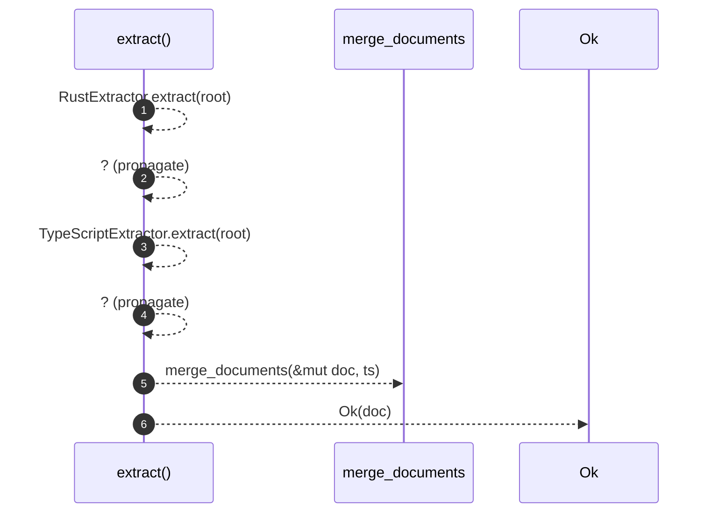

# `robby_extract::extract`

[Self-model](../README.md) · [robby_extract](index.md)

| | |
|---|---|
| kind | `code.function` |
| signature | `fn extract(root: &Path) -> Result<Document>` |
| location | [`crates/robby-extract/src/lib.rs:62`](../../../crates/robby-extract/src/lib.rs#L62) |
| provenance | extractor · confidence 1.00 |

> Extract a document describing Rust crates and TypeScript packages under `root`.

```rust
/// Extract a document describing Rust crates and TypeScript packages under `root`.
pub fn extract(root: &Path) -> Result<Document> {
    let mut doc = RustExtractor.extract(root)?;
    let ts = TypeScriptExtractor.extract(root)?;
    merge_documents(&mut doc, ts);
    Ok(doc)
}
```



6 steps · 0 observed · 6 possible only

**Edges**

- calls → [`robby_extract::extract`](extract.md)
- calls → [`robby_extract::extract`](extract.md)
- calls → [`robby_extract::merge_documents`](merge-documents.md)

## References

- calls → [`robby_extract`](index.md) — merge_documents

## Referenced by

- calls ← [`robby_extract::extract_with`](extract-with.md)
- calls ← [`robby_extract::test_extract::every_source_file_is_declared`](test_extract/every-source-file-is-declared.md)
- calls ← [`robby_extract::test_extract::functions_produce_process_steps`](test_extract/functions-produce-process-steps.md)
- calls ← [`robby_extract::test_extract::spans_point_at_the_right_bytes`](test_extract/spans-point-at-the-right-bytes.md)
- calls ← [`robby_extract::test_extract::the_workspace_is_fully_covered`](test_extract/the-workspace-is-fully-covered.md)
- calls ← [`robby_extract::test_typescript::bare_import_creates_external_npm_stub`](test_typescript/bare-import-creates-external-npm-stub.md)
- calls ← [`robby_extract::test_typescript::emits_comment_nodes_and_attaches_docs`](test_typescript/emits-comment-nodes-and-attaches-docs.md)
- calls ← [`robby_extract::test_typescript::extracts_typescript_package_with_lang_tag`](test_typescript/extracts-typescript-package-with-lang-tag.md)
- calls ← [`robby_extract::test_typescript::resolves_calls_and_imports`](test_typescript/resolves-calls-and-imports.md)
- calls ← [`robby_extract::test_typescript::typescript_fixture_is_fully_covered`](test_typescript/typescript-fixture-is-fully-covered.md)

