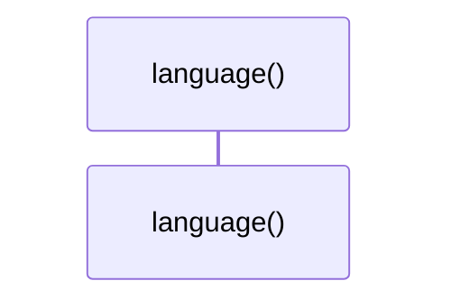
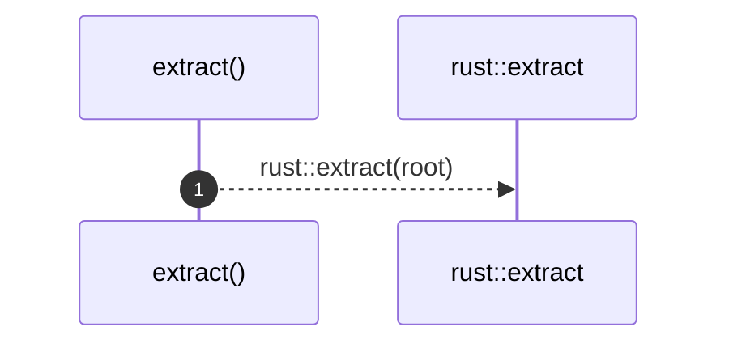
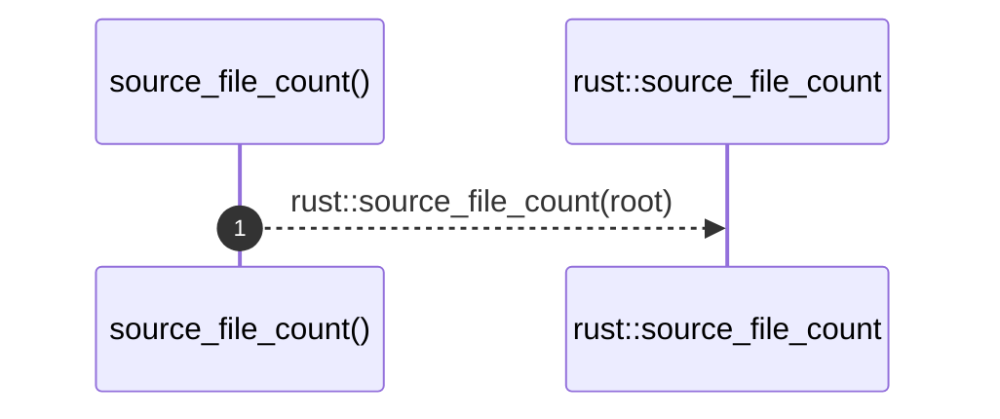

# `robby_extract::impl LanguageExtractor for RustExtractor`

[Self-model](../README.md) · [robby_extract](index.md)

| | |
|---|---|
| kind | `code.impl` |
| location | [`crates/robby-extract/src/lib.rs:30`](../../../crates/robby-extract/src/lib.rs#L30) |
| provenance | extractor · confidence 1.00 |

```rust
impl LanguageExtractor for RustExtractor {
    fn language(&self) -> Lang {
        Lang::Rust
    }

    fn extract(&self, root: &Path) -> Result<Document> {
        rust::extract(root)
    }

    fn source_file_count(&self, root: &Path) -> Result<usize> {
        rust::source_file_count(root)
    }
}
```

### `language`

| | |
|---|---|
| kind | `code.method` |
| signature | `fn language(1)` |
| location | [`crates/robby-extract/src/lib.rs:31`](../../../crates/robby-extract/src/lib.rs#L31) |
| provenance | extractor · confidence 1.00 |

```rust
fn language(&self) -> Lang {
        Lang::Rust
    }
```



0 steps · 0 observed · 0 possible only

### `extract`

| | |
|---|---|
| kind | `code.method` |
| signature | `fn extract(2)` |
| location | [`crates/robby-extract/src/lib.rs:35`](../../../crates/robby-extract/src/lib.rs#L35) |
| provenance | extractor · confidence 1.00 |

```rust
fn extract(&self, root: &Path) -> Result<Document> {
        rust::extract(root)
    }
```



1 steps · 0 observed · 1 possible only

**Edges**

- calls → [`robby_extract::impl LanguageExtractor for RustExtractor::extract`](index.md)

### `source_file_count`

| | |
|---|---|
| kind | `code.method` |
| signature | `fn source_file_count(2)` |
| location | [`crates/robby-extract/src/lib.rs:39`](../../../crates/robby-extract/src/lib.rs#L39) |
| provenance | extractor · confidence 1.00 |

```rust
fn source_file_count(&self, root: &Path) -> Result<usize> {
        rust::source_file_count(root)
    }
```



1 steps · 0 observed · 1 possible only

**Edges**

- calls → [`robby_extract::impl LanguageExtractor for RustExtractor::source_file_count`](index.md)

