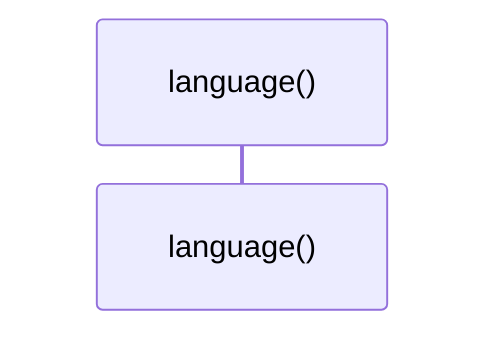
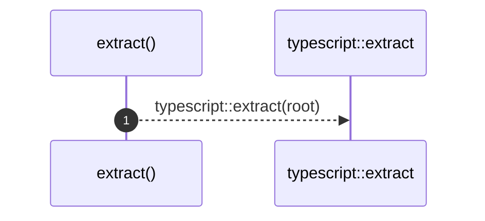
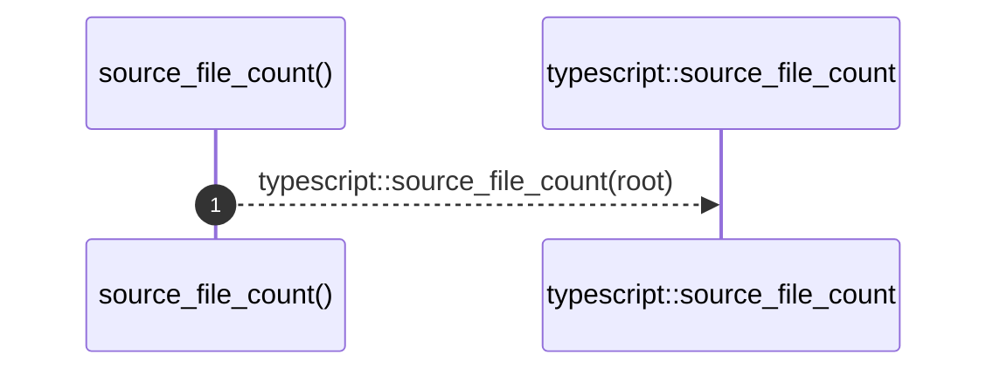

# `robby_extract::impl LanguageExtractor for TypeScriptExtractor`

[Self-model](../README.md) · [robby_extract](index.md)

| | |
|---|---|
| kind | `code.impl` |
| location | [`crates/robby-extract/src/lib.rs:48`](../../../crates/robby-extract/src/lib.rs#L48) |
| provenance | extractor · confidence 1.00 |

```rust
impl LanguageExtractor for TypeScriptExtractor {
    fn language(&self) -> Lang {
        Lang::TypeScript
    }

    fn extract(&self, root: &Path) -> Result<Document> {
        typescript::extract(root)
    }

    fn source_file_count(&self, root: &Path) -> Result<usize> {
        typescript::source_file_count(root)
    }
}
```

### `language`

| | |
|---|---|
| kind | `code.method` |
| signature | `fn language(1)` |
| location | [`crates/robby-extract/src/lib.rs:49`](../../../crates/robby-extract/src/lib.rs#L49) |
| provenance | extractor · confidence 1.00 |

```rust
fn language(&self) -> Lang {
        Lang::TypeScript
    }
```



0 steps · 0 observed · 0 possible only

### `extract`

| | |
|---|---|
| kind | `code.method` |
| signature | `fn extract(2)` |
| location | [`crates/robby-extract/src/lib.rs:53`](../../../crates/robby-extract/src/lib.rs#L53) |
| provenance | extractor · confidence 1.00 |

```rust
fn extract(&self, root: &Path) -> Result<Document> {
        typescript::extract(root)
    }
```



1 steps · 0 observed · 1 possible only

**Edges**

- calls → [`robby_extract::impl LanguageExtractor for TypeScriptExtractor::extract`](index.md)

### `source_file_count`

| | |
|---|---|
| kind | `code.method` |
| signature | `fn source_file_count(2)` |
| location | [`crates/robby-extract/src/lib.rs:57`](../../../crates/robby-extract/src/lib.rs#L57) |
| provenance | extractor · confidence 1.00 |

```rust
fn source_file_count(&self, root: &Path) -> Result<usize> {
        typescript::source_file_count(root)
    }
```



1 steps · 0 observed · 1 possible only

**Edges**

- calls → [`robby_extract::impl LanguageExtractor for TypeScriptExtractor::source_file_count`](index.md)

