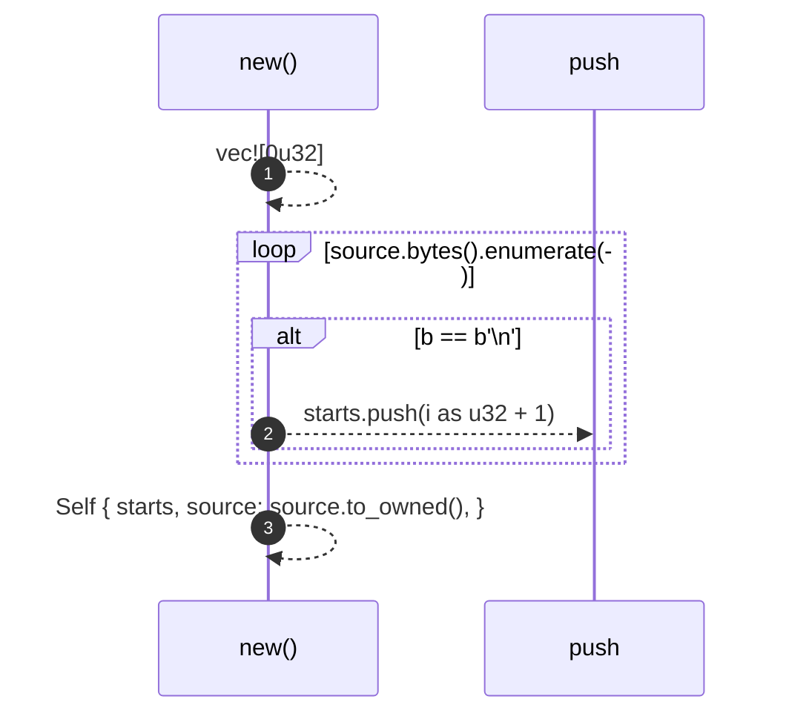
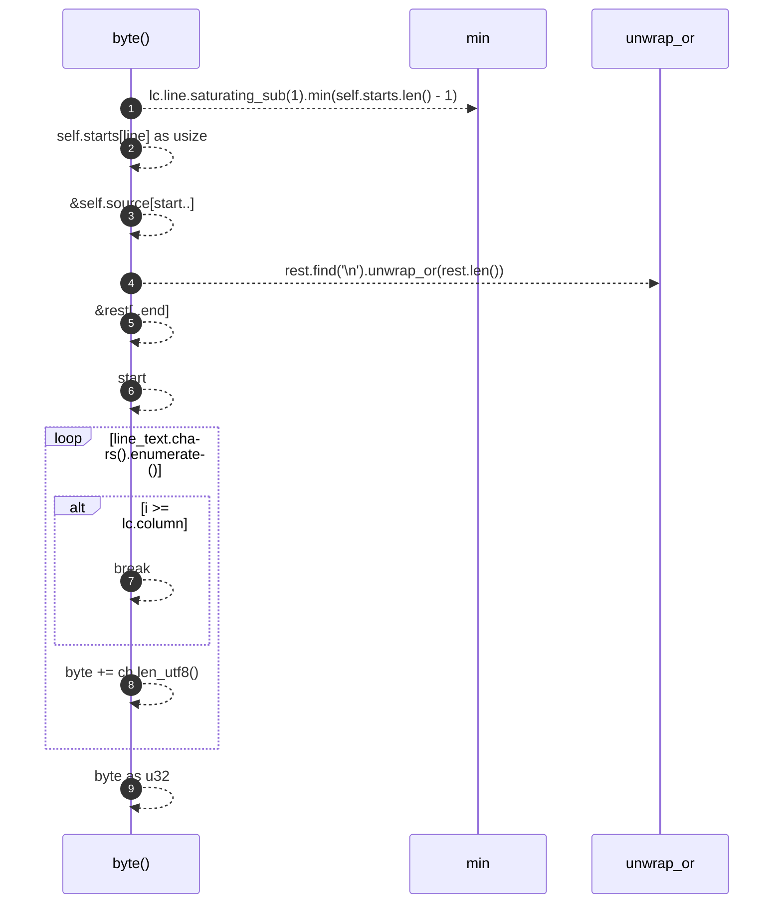

# `robby_extract::impl LineIndex`

[Self-model](../README.md) · [robby_extract](index.md)

| | |
|---|---|
| kind | `code.impl` |
| location | [`crates/robby-extract/src/lib.rs:485`](../../../crates/robby-extract/src/lib.rs#L485) |
| provenance | extractor · confidence 1.00 |

```rust
impl LineIndex {
    pub fn new(source: &str) -> Self {
        let mut starts = vec![0u32];
        for (i, b) in source.bytes().enumerate() {
            if b == b'\n' {
                starts.push(i as u32 + 1);
            }
        }
        Self {
            starts,
            source: source.to_owned(),
        }
    }

    pub fn byte(&self, lc: LineColumn) -> u32 {
        let line = lc.line.saturating_sub(1).min(self.starts.len() - 1);
        let start = self.starts[line] as usize;
        let rest = &self.source[start..];
        let end = rest.find('\n').unwrap_or(rest.len());
        let line_text = &rest[..end];
        let mut byte = start;
        for (i, ch) in line_text.chars().enumerate() {
            if i >= lc.column {
                break;
            }
            byte += ch.len_utf8();
        }
        byte as u32
    }
}
```

### `new`

| | |
|---|---|
| kind | `code.method` |
| signature | `fn new(1)` |
| location | [`crates/robby-extract/src/lib.rs:486`](../../../crates/robby-extract/src/lib.rs#L486) |
| provenance | extractor · confidence 1.00 |

```rust
pub fn new(source: &str) -> Self {
        let mut starts = vec![0u32];
        for (i, b) in source.bytes().enumerate() {
            if b == b'\n' {
                starts.push(i as u32 + 1);
            }
        }
        Self {
            starts,
            source: source.to_owned(),
        }
    }
```



3 steps · 0 observed · 3 possible only

### `byte`

| | |
|---|---|
| kind | `code.method` |
| signature | `fn byte(2)` |
| location | [`crates/robby-extract/src/lib.rs:499`](../../../crates/robby-extract/src/lib.rs#L499) |
| provenance | extractor · confidence 1.00 |

```rust
pub fn byte(&self, lc: LineColumn) -> u32 {
        let line = lc.line.saturating_sub(1).min(self.starts.len() - 1);
        let start = self.starts[line] as usize;
        let rest = &self.source[start..];
        let end = rest.find('\n').unwrap_or(rest.len());
        let line_text = &rest[..end];
        let mut byte = start;
        for (i, ch) in line_text.chars().enumerate() {
            if i >= lc.column {
                break;
            }
            byte += ch.len_utf8();
        }
        byte as u32
    }
```



9 steps · 0 observed · 9 possible only

