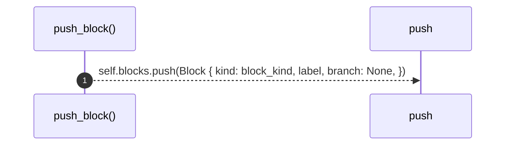
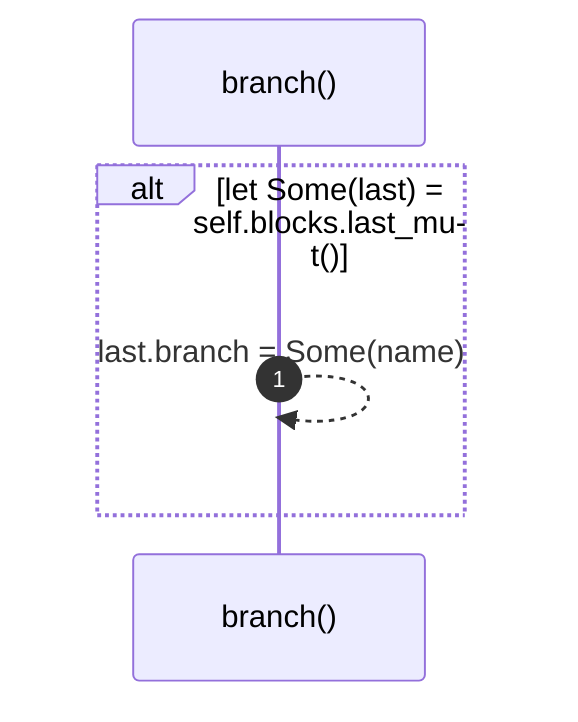
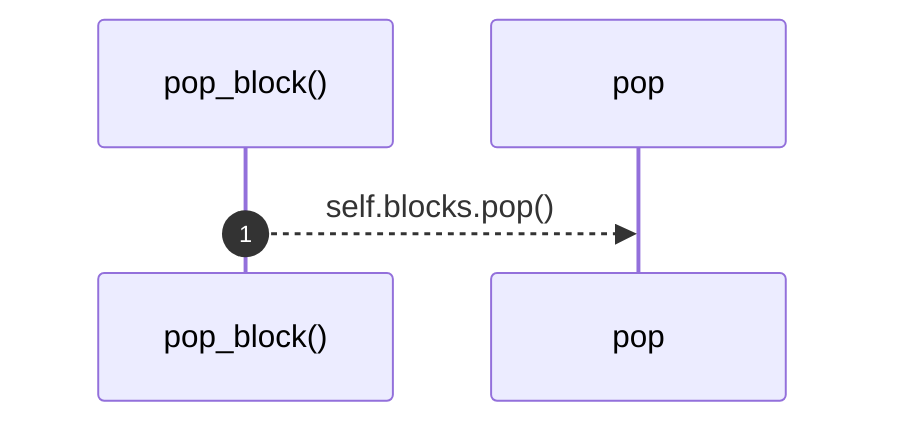

# `robby_extract::impl ProcBuilder<'_, '_>`

[Self-model](../README.md) · [robby_extract](index.md)

| | |
|---|---|
| kind | `code.impl` |
| location | [`crates/robby-extract/src/lib.rs:595`](../../../crates/robby-extract/src/lib.rs#L595) |
| provenance | extractor · confidence 1.00 |

```rust
impl ProcBuilder<'_, '_> {
    fn emit(&mut self, to: &str, label: String, step_kind: StepKind, span: Span) {
        let from = sanitize(&self.me);
        let to_id = sanitize(to);
        if from == to_id {
            self.process
                .participant(to_id.clone(), self.me.clone(), Kind::from(kind::code::FUNCTION));
        } else {
            self.process
                .participant(to_id.clone(), to.to_owned(), Kind::from(kind::code::FUNCTION));
        }
        self.process.step(Step {
            from,
            to: to_id,
            label,
            kind: step_kind,
            observed: false,
            span: Some(span),
            blocks: self.blocks.clone(),
        });
    }

    fn push_block(&mut self, block_kind: BlockKind, label: String) {
        self.blocks.push(Block {
            kind: block_kind,
            label,
            branch: None,
        });
    }

    fn branch(&mut self, name: String) {
        if let Some(last) = self.blocks.last_mut() {
            last.branch = Some(name);
        }
    }

    fn pop_block(&mut self) {
        self.blocks.pop();
    }
}
```

### `emit`

| | |
|---|---|
| kind | `code.method` |
| signature | `fn emit(5)` |
| location | [`crates/robby-extract/src/lib.rs:596`](../../../crates/robby-extract/src/lib.rs#L596) |
| provenance | extractor · confidence 1.00 |

```rust
fn emit(&mut self, to: &str, label: String, step_kind: StepKind, span: Span) {
        let from = sanitize(&self.me);
        let to_id = sanitize(to);
        if from == to_id {
            self.process
                .participant(to_id.clone(), self.me.clone(), Kind::from(kind::code::FUNCTION));
        } else {
            self.process
                .participant(to_id.clone(), to.to_owned(), Kind::from(kind::code::FUNCTION));
        }
        self.process.step(Step {
            from,
            to: to_id,
            label,
            kind: step_kind,
            observed: false,
            span: Some(span),
            blocks: self.blocks.clone(),
        });
    }
```

```mermaid
sequenceDiagram
    autonumber
    participant emit as emit()
    participant sanitize as sanitize
    participant participant as participant
    participant step as step
    emit-->>sanitize: sanitize(&self.me)
    emit-->>sanitize: sanitize(to)
    alt from == to_id
    emit-->>participant: self.process .participant(to_id.clone(), self.me.clone(), Kind::from(...
    else else
    emit-->>participant: self.process .participant(to_id.clone(), to.to_owned(), Kind::from(ki...
    end
    emit-->>step: self.process.step(Step { from, to: to_id, label, kind: step_kind, obs...
```

5 steps · 0 observed · 5 possible only

**Edges**

- calls → [`robby_extract::sanitize`](sanitize.md)
- calls → [`robby_extract::sanitize`](sanitize.md)
- calls → [`robby_ir::process::impl Process::participant`](../robby_ir/process/index.md)
- calls → [`robby_ir::process::impl Process::participant`](../robby_ir/process/index.md)
- calls → [`robby_ir::process::impl Process::step`](../robby_ir/process/index.md)

### `push_block`

| | |
|---|---|
| kind | `code.method` |
| signature | `fn push_block(3)` |
| location | [`crates/robby-extract/src/lib.rs:617`](../../../crates/robby-extract/src/lib.rs#L617) |
| provenance | extractor · confidence 1.00 |

```rust
fn push_block(&mut self, block_kind: BlockKind, label: String) {
        self.blocks.push(Block {
            kind: block_kind,
            label,
            branch: None,
        });
    }
```



1 steps · 0 observed · 1 possible only

### `branch`

| | |
|---|---|
| kind | `code.method` |
| signature | `fn branch(2)` |
| location | [`crates/robby-extract/src/lib.rs:625`](../../../crates/robby-extract/src/lib.rs#L625) |
| provenance | extractor · confidence 1.00 |

```rust
fn branch(&mut self, name: String) {
        if let Some(last) = self.blocks.last_mut() {
            last.branch = Some(name);
        }
    }
```



1 steps · 0 observed · 1 possible only

### `pop_block`

| | |
|---|---|
| kind | `code.method` |
| signature | `fn pop_block(1)` |
| location | [`crates/robby-extract/src/lib.rs:631`](../../../crates/robby-extract/src/lib.rs#L631) |
| provenance | extractor · confidence 1.00 |

```rust
fn pop_block(&mut self) {
        self.blocks.pop();
    }
```



1 steps · 0 observed · 1 possible only

