# `robby_extract`

[Self-model](../README.md)

| | |
|---|---|
| kind | `code.crate` |
| provenance | extractor · confidence 1.00 |
| nodes | 75 |

```mermaid
flowchart TD
    subgraph n_ea78dce2fbcbf64f["robby_extract [crate]"]
        direction TB
        n_9a097a01ca297a4c["fn extract(root: &Path) -> Result<Document> [function]"]
        n_8be1e48b2b8bdf9e["Krate [struct]"]
        n_90ac5d83c0d31bed["fn discover_crates(root: &Path) -> Result<Vec<Krate>> [function]"]
        n_d22f1036d1fea2cd["fn rust_files(crate_dir: &Path) -> Result<Vec<PathBuf>> [function]"]
        n_66455b438a18450b["fn collect_rs(dir: &Path, out: &mut Vec<PathBuf>) -> Result<()> [function]"]
        n_dd2847d9d111f18b["fn module_path(krate: &Krate, file: &Path) -> String [function]"]
        n_303a2112c257c3cf["fn extract_file( doc: &mut Document, krate: &Krate, file: &Path, pending: &mut Vec<PendingCall>, ) -> Result<()> [function]"]
        n_5b74d9bf8557b758["Ctx [struct]"]
        n_f82931f261a19081["fn walk_items( doc: &mut Document, items: &[Item], parent: &NodeId, ctx: &Ctx<'_>, pending: &mut Vec<PendingCall>, ) [function]"]
        n_40237ada93dee4dd["fn item_node(kind_name: &str, fqn: &str, span: Span, parent: &NodeId) -> Node [function]"]
        n_201b1694722d9dd5["fn signature_of(f: &syn::ItemFn, ctx: &Ctx<'_>) -> String [function]"]
        n_442155585964a4e8["fn docs_of<T: Spanned>(_t: &T, attrs: &[syn::Attribute]) -> Option<String> [function]"]
        n_c12ed1595223e66e["fn path_text(path: &syn::Path) -> String [function]"]
        n_f76d1ff3e87c8bbf["fn type_text(ty: &Type) -> String [function]"]
        n_dacb87e5cfda8cf3["LineIndex [struct]"]
        n_4c8267128970eb8d["fn span_of<T: Spanned>(node: &T, ctx: &Ctx<'_>) -> Span [function]"]
        n_4fdbb34c2a7a1f0f["fn slice(ctx: &Ctx<'_>, span: Span) -> String [function]"]
        n_2ee055e2aeff2a69["fn label_of(ctx: &Ctx<'_>, span: Span) -> String [function]"]
        n_020f8711f2581532["PendingCall [struct]"]
        n_f663fea0a3c903c3["fn build_process( f: &syn::ItemFn, ctx: &Ctx<'_>, fqn: &str, pending: &mut Vec<PendingCall>, ) -> Process [function]"]
        n_1346d7fa232f33b9["fn build_process_sig( sig: &syn::Signature, block: &syn::Block, ctx: &Ctx<'_>, fqn: &str, pending: &mut Vec<PendingCall>, ) -> Process [function]"]
        n_7dfa0b21848fcda6["ProcBuilder [struct]"]
        n_fc936569b3c25d9e["fn walk_stmts(builder: &mut ProcBuilder<'_, '_>, stmts: &[Stmt]) [function]"]
        n_74e69a4b8cf9495c["fn walk_expr(builder: &mut ProcBuilder<'_, '_>, expr: &Expr) [function]"]
        n_c9c1ef85c6326230["fn callee_display(func: &Expr) -> String [function]"]
        n_b9ae66f2ba8eccf1["fn callee_name(func: &Expr) -> String [function]"]
        n_9e749484aa968ed8["fn sanitize(input: &str) -> String [function]"]
        n_083de5a3b1f9c58f["fn resolve_calls(doc: &mut Document, pending: Vec<PendingCall>) [function]"]
        n_0478cf609a402211["fn source_file_count(root: &Path) -> Result<usize> [function]"]
        n_ab1886309bf3ff98["tests [module]"]
        n_286b1b9602b65f8d["test_extract [module]"]
    end
    n_1346d7fa232f33b9 -->|calls| n_fc936569b3c25d9e
    n_201b1694722d9dd5 -->|calls| n_4fdbb34c2a7a1f0f
    n_2ee055e2aeff2a69 -->|calls| n_4fdbb34c2a7a1f0f
    n_303a2112c257c3cf -->|calls| n_dd2847d9d111f18b
    n_303a2112c257c3cf -->|calls| n_f82931f261a19081
    n_66455b438a18450b -->|calls| n_66455b438a18450b
    n_74e69a4b8cf9495c -->|calls| n_2ee055e2aeff2a69
    n_74e69a4b8cf9495c -->|calls| n_4c8267128970eb8d
    n_74e69a4b8cf9495c -->|calls| n_74e69a4b8cf9495c
    n_74e69a4b8cf9495c -->|calls| n_b9ae66f2ba8eccf1
    n_74e69a4b8cf9495c -->|calls| n_c9c1ef85c6326230
    n_74e69a4b8cf9495c -->|calls| n_fc936569b3c25d9e
    n_90ac5d83c0d31bed -->|calls| n_d22f1036d1fea2cd
    n_9a097a01ca297a4c -->|calls| n_083de5a3b1f9c58f
    n_9a097a01ca297a4c -->|calls| n_303a2112c257c3cf
    n_9a097a01ca297a4c -->|calls| n_90ac5d83c0d31bed
    n_c9c1ef85c6326230 -->|calls| n_b9ae66f2ba8eccf1
    n_c9c1ef85c6326230 -->|calls| n_c12ed1595223e66e
    n_d22f1036d1fea2cd -->|calls| n_66455b438a18450b
    n_f663fea0a3c903c3 -->|calls| n_1346d7fa232f33b9
    n_f76d1ff3e87c8bbf -->|calls| n_c12ed1595223e66e
    n_f76d1ff3e87c8bbf -->|calls| n_f76d1ff3e87c8bbf
    n_f82931f261a19081 -->|calls| n_40237ada93dee4dd
    n_f82931f261a19081 -->|calls| n_4c8267128970eb8d
    n_f82931f261a19081 -->|calls| n_f76d1ff3e87c8bbf
    n_f82931f261a19081 -->|calls| n_f82931f261a19081
    n_fc936569b3c25d9e -->|calls| n_4c8267128970eb8d
    n_fc936569b3c25d9e -->|calls| n_74e69a4b8cf9495c
```

## Modules

- [`tests`](tests/index.md) — 3 nodes
- [`test_extract`](test_extract/index.md) — 8 nodes

## Items

| Item | Kind | Steps | Location |
|---|---|---:|---|
| [`extract`](extract.md) | `code.function` | 11 | `crates/robby-extract/src/lib.rs:31:1` |
| [`Krate`](krate.md) | `code.struct` | — | `crates/robby-extract/src/lib.rs:55:1` |
| [`discover_crates`](discover-crates.md) | `code.function` | 11 | `crates/robby-extract/src/lib.rs:61:1` |
| [`rust_files`](rust-files.md) | `code.function` | 11 | `crates/robby-extract/src/lib.rs:86:1` |
| [`collect_rs`](collect-rs.md) | `code.function` | 8 | `crates/robby-extract/src/lib.rs:99:1` |
| [`module_path`](module-path.md) | `code.function` | 14 | `crates/robby-extract/src/lib.rs:117:1` |
| [`extract_file`](extract-file.md) | `code.function` | 16 | `crates/robby-extract/src/lib.rs:146:1` |
| [`Ctx`](ctx.md) | `code.struct` | — | `crates/robby-extract/src/lib.rs:186:1` |
| [`walk_items`](walk-items.md) | `code.function` | 77 | `crates/robby-extract/src/lib.rs:193:1` |
| [`item_node`](item-node.md) | `code.function` | 7 | `crates/robby-extract/src/lib.rs:383:1` |
| [`signature_of`](signature-of.md) | `code.function` | 2 | `crates/robby-extract/src/lib.rs:393:1` |
| [`docs_of`](docs-of.md) | `code.function` | 4 | `crates/robby-extract/src/lib.rs:398:1` |
| [`path_text`](path-text.md) | `code.function` | 1 | `crates/robby-extract/src/lib.rs:421:1` |
| [`type_text`](type-text.md) | `code.function` | 9 | `crates/robby-extract/src/lib.rs:446:1` |
| [`LineIndex`](lineindex.md) | `code.struct` | — | `crates/robby-extract/src/lib.rs:475:1` |
| [`impl LineIndex`](impl-lineindex.md) | `code.impl` | — | `crates/robby-extract/src/lib.rs:485:1` |
| [`span_of`](span-of.md) | `code.function` | 4 | `crates/robby-extract/src/lib.rs:516:1` |
| [`slice`](slice.md) | `code.function` | 1 | `crates/robby-extract/src/lib.rs:523:1` |
| [`label_of`](label-of.md) | `code.function` | 5 | `crates/robby-extract/src/lib.rs:530:1` |
| [`PendingCall`](pendingcall.md) | `code.struct` | — | `crates/robby-extract/src/lib.rs:545:1` |
| [`build_process`](build-process.md) | `code.function` | 1 | `crates/robby-extract/src/lib.rs:551:1` |
| [`build_process_sig`](build-process-sig.md) | `code.function` | 6 | `crates/robby-extract/src/lib.rs:560:1` |
| [`ProcBuilder`](procbuilder.md) | `code.struct` | — | `crates/robby-extract/src/lib.rs:586:1` |
| [`impl ProcBuilder<'_, '_>`](impl-procbuilder.md) | `code.impl` | — | `crates/robby-extract/src/lib.rs:595:1` |
| [`walk_stmts`](walk-stmts.md) | `code.function` | 10 | `crates/robby-extract/src/lib.rs:636:1` |
| [`walk_expr`](walk-expr.md) | `code.function` | 50 | `crates/robby-extract/src/lib.rs:666:1` |
| [`callee_display`](callee-display.md) | `code.function` | 2 | `crates/robby-extract/src/lib.rs:759:1` |
| [`callee_name`](callee-name.md) | `code.function` | 4 | `crates/robby-extract/src/lib.rs:767:1` |
| [`sanitize`](sanitize.md) | `code.function` | 6 | `crates/robby-extract/src/lib.rs:784:1` |
| [`resolve_calls`](resolve-calls.md) | `code.function` | 10 | `crates/robby-extract/src/lib.rs:806:1` |
| [`source_file_count`](source-file-count.md) | `code.function` | 1 | `crates/robby-extract/src/lib.rs:834:1` |

## Imports

- `use std::collections::BTreeMap;`
- `use std::fs;`
- `use std::path::{Path, PathBuf};`
- `use anyhow::{Context, Result};`
- `use proc_macro2::LineColumn;`
- `use robby_ir::{`
- `use syn::spanned::Spanned;`
- `use syn::{Expr, Item, Stmt, Type};`

