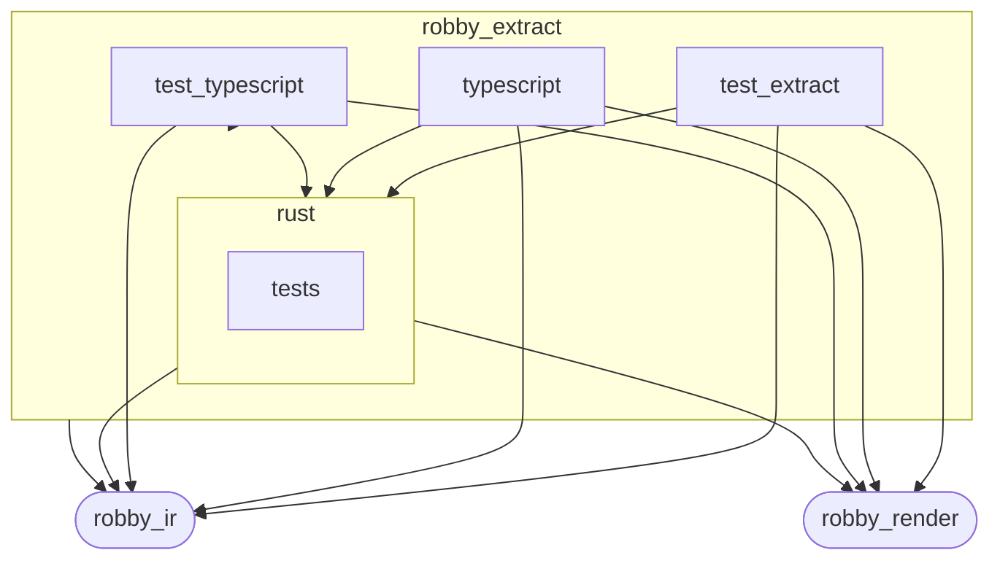

# `robby_extract`

[Self-model](../README.md)

| | |
|---|---|
| kind | `code.crate` |
| provenance | extractor · confidence 1.00 |
| nodes | 164 |

## Package diagram



## Module coupling

```mermaid
flowchart TB
    subgraph n_ea78dce2fbcbf64f["robby_extract"]
        direction TB
        subgraph n_a95c010a8299da11["rust"]
            direction TB
            n_00e670e0fe5e368a["branch"]
            n_2e869108f4860bed["build_process"]
            n_0f65d8e0fcc6247f["build_process_sig"]
            n_7aed70fa5f530043["byte"]
            n_e0aff4d7ad1207be["callee_display"]
            n_7c0adbff2a4d8453["callee_name"]
            n_679aecb6a44a0b7d["collect_rs"]
            n_fa1271699af1636f["discover_crates"]
            n_27aab962727b45b6["docs_of"]
            n_0b7fb84245603f15["emit"]
            n_1bde06ec58273cea["extract"]
            n_ef635844bddcf7e1["extract_file"]
            n_d28472b55fee0f76["id_fqn"]
            n_650659dfe62a65ef["item_node"]
            n_892332fc0b489f53["label_of"]
            n_d125c18de590c914["line_index_handles_non_ascii"]
            n_be96122d6baee981["module_path"]
            n_245831ade8589906["module_prefix"]
            n_3d45ae7c14c050a5["new"]
            n_7598b208a83997b8["path_text"]
            n_1e1aa9caf8f26a21["pick_call_prefers_same_module"]
            n_b5b84581b05cb76f["pick_call_target"]
            n_69f0a9313046642f["pop_block"]
            n_bd9191c7b36f1f58["push_block"]
            n_ccdbd1cda9cd2829["resolve_calls"]
            n_22e992d880112533["rust_files"]
            n_23c84b2d0e41cc06["sanitize"]
            n_5f193ee8abca963c["shared_module_score"]
            n_cfd4e690409a9c13["signature_of"]
            n_c0f769058db96d25["slice"]
            n_6f4ea505bb50f03f["source_file_count"]
            n_55b1c39de138eeff["span_of"]
            n_d50c0ac601bc59b9["type_text"]
            n_e2da56648b8aafaa["walk_expr"]
            n_494ba2a3fa438ab3["walk_items"]
            n_e0f46f8e875851fc["walk_stmts"]
        end
        subgraph n_286b1b9602b65f8d["test_extract"]
            direction TB
            n_7c330d99659d9a6b["every_source_file_is_declared"]
            n_f0deac31d986e98f["functions_produce_process_steps"]
            n_e15579d20b9b2edd["root"]
            n_3bac05e8319828b4["spans_point_at_the_right_bytes"]
            n_96f42359af8dd731["the_workspace_is_fully_covered"]
        end
        subgraph n_707c83973fcabf1f["test_typescript"]
            direction TB
            n_b8e37ee0e00d2102["bare_import_creates_external_npm_stub"]
            n_7eb75d53fd7f0121["emits_comment_nodes_and_attaches_docs"]
            n_be1b7fb4407a7ecb["extracts_typescript_package_with_lang_tag"]
            n_1b53af5a44fa5068["fixture"]
            n_1d410cca2cf6459b["resolves_calls_and_imports"]
            n_b0a6b64e43c0a4f9["typescript_fixture_is_fully_covered"]
        end
        subgraph n_65efc424c4086ad0["typescript"]
            direction TB
            n_f14210b38e26553a["attach_leading_docs"]
            n_13d86de50d18a18b["build_function_process"]
            n_bee5d575e09d876c["callee_name"]
            n_f4803787d8f527f2["collect_ts"]
            n_4cbc254ffa1457b5["discover_packages"]
            n_87c1276a78c09f88["emit_class"]
            n_47feaf4034c26ed2["emit_comments"]
            n_485a3969752a1298["emit_function"]
            n_04598dcdf47019ad["emit_import"]
            n_17996a87532989b3["emit_interface"]
            n_caff78299d2ed171["emit_method"]
            n_feb24023ec942990["emit_variable"]
            n_aad6691009267c88["ensure_participant"]
            n_bf8cfe5cfa98750d["extract"]
            n_0c344646800e99f0["extract_file"]
            n_be06ebcc5fcd4ba9["frame"]
            n_88f246698f7eb41b["gap_is_attachable"]
            n_18d198c74ea04d46["is_bare_specifier"]
            n_7d29750052578457["is_ts_file"]
            n_5ab6cfad2ebb2650["item_node"]
            n_359f9b30d43ad0b3["js_str"]
            n_24ac9120671328b6["module_fqn"]
            n_56241572ad7bd4e9["oxc_span"]
            n_4a57576dbc87afdc["package_at"]
            n_ba75a4c20110a7c5["property_key_name"]
            n_40e148562374c12f["push_step"]
            n_d78d1f9e4f7f4b4f["read_package_name"]
            n_dc68f8404f699d3e["resolve_calls"]
            n_7a24a36ee6ffdb5b["resolve_relative_import"]
            n_1c1c14a8e043f39b["sanitize"]
            n_64025b8cb8f6d298["sanitize_pkg_name"]
            n_8051e23fb2af7ea8["source_file_count"]
            n_76bf9abc00c1141e["strip_ts_ext"]
            n_54826fe250c38efd["ts_files"]
            n_c2b42a76fe622bfa["type_name"]
            n_b04061d398b2e10c["type_name_expr"]
            n_b9edaceaf370369e["walk_declaration"]
            n_49d6d40590eeb5b1["walk_expr"]
            n_701cdf9a411c4304["walk_statements"]
            n_9823549b185de270["walk_stmt"]
            n_e1eac68a67870b19["walk_stmts"]
        end
        n_9a097a01ca297a4c["extract"]
        n_6b8440ffa3a2e7c0["merge_documents"]
        n_0478cf609a402211["source_file_count"]
    end
    n_04598dcdf47019ad --> n_18d198c74ea04d46
    n_04598dcdf47019ad --> n_359f9b30d43ad0b3
    n_04598dcdf47019ad -->|"3"| n_3d45ae7c14c050a5
    n_04598dcdf47019ad --> n_56241572ad7bd4e9
    n_04598dcdf47019ad --> n_5ab6cfad2ebb2650
    n_04598dcdf47019ad --> n_7a24a36ee6ffdb5b
    n_0b7fb84245603f15 -->|"2"| n_23c84b2d0e41cc06
    n_0c344646800e99f0 --> n_24ac9120671328b6
    n_0c344646800e99f0 -->|"3"| n_3d45ae7c14c050a5
    n_0c344646800e99f0 --> n_47feaf4034c26ed2
    n_0c344646800e99f0 --> n_701cdf9a411c4304
    n_0c344646800e99f0 --> n_f14210b38e26553a
    n_0f65d8e0fcc6247f --> n_23c84b2d0e41cc06
    n_0f65d8e0fcc6247f -->|"2"| n_3d45ae7c14c050a5
    n_0f65d8e0fcc6247f --> n_e0f46f8e875851fc
    n_13d86de50d18a18b --> n_1c1c14a8e043f39b
    n_13d86de50d18a18b --> n_3d45ae7c14c050a5
    n_13d86de50d18a18b --> n_e1eac68a67870b19
    n_17996a87532989b3 --> n_3d45ae7c14c050a5
    n_17996a87532989b3 --> n_56241572ad7bd4e9
    n_17996a87532989b3 --> n_5ab6cfad2ebb2650
    n_17996a87532989b3 --> n_c2b42a76fe622bfa
    n_1bde06ec58273cea -->|"4"| n_3d45ae7c14c050a5
    n_1bde06ec58273cea --> n_ccdbd1cda9cd2829
    n_1bde06ec58273cea --> n_ef635844bddcf7e1
    n_1bde06ec58273cea --> n_fa1271699af1636f
    n_1d410cca2cf6459b --> n_1b53af5a44fa5068
    n_1d410cca2cf6459b --> n_9a097a01ca297a4c
    n_1e1aa9caf8f26a21 --> n_b5b84581b05cb76f
    n_22e992d880112533 --> n_3d45ae7c14c050a5
    n_22e992d880112533 -->|"3"| n_679aecb6a44a0b7d
    n_24ac9120671328b6 --> n_76bf9abc00c1141e
    n_27aab962727b45b6 --> n_3d45ae7c14c050a5
    n_2e869108f4860bed --> n_0f65d8e0fcc6247f
    n_3bac05e8319828b4 --> n_9a097a01ca297a4c
    n_3bac05e8319828b4 --> n_e15579d20b9b2edd
    n_40e148562374c12f --> n_3d45ae7c14c050a5
    n_47feaf4034c26ed2 --> n_56241572ad7bd4e9
    n_47feaf4034c26ed2 --> n_5ab6cfad2ebb2650
    n_485a3969752a1298 --> n_13d86de50d18a18b
    n_485a3969752a1298 --> n_56241572ad7bd4e9
    n_485a3969752a1298 --> n_5ab6cfad2ebb2650
    n_494ba2a3fa438ab3 --> n_0f65d8e0fcc6247f
    n_494ba2a3fa438ab3 -->|"5"| n_27aab962727b45b6
    n_494ba2a3fa438ab3 --> n_2e869108f4860bed
    n_494ba2a3fa438ab3 -->|"7"| n_55b1c39de138eeff
    n_494ba2a3fa438ab3 -->|"22"| n_650659dfe62a65ef
    n_494ba2a3fa438ab3 --> n_cfd4e690409a9c13
    n_494ba2a3fa438ab3 --> n_d50c0ac601bc59b9
    n_49d6d40590eeb5b1 -->|"2"| n_1c1c14a8e043f39b
    n_49d6d40590eeb5b1 -->|"7"| n_40e148562374c12f
    n_49d6d40590eeb5b1 -->|"2"| n_56241572ad7bd4e9
    n_49d6d40590eeb5b1 -->|"2"| n_aad6691009267c88
    n_49d6d40590eeb5b1 -->|"2"| n_be06ebcc5fcd4ba9
    n_49d6d40590eeb5b1 -->|"2"| n_bee5d575e09d876c
    n_4a57576dbc87afdc --> n_54826fe250c38efd
    n_4a57576dbc87afdc --> n_64025b8cb8f6d298
    n_4a57576dbc87afdc --> n_d78d1f9e4f7f4b4f
    n_4cbc254ffa1457b5 --> n_3d45ae7c14c050a5
    n_4cbc254ffa1457b5 -->|"2"| n_4a57576dbc87afdc
    n_54826fe250c38efd --> n_3d45ae7c14c050a5
    n_54826fe250c38efd -->|"2"| n_f4803787d8f527f2
    n_55b1c39de138eeff --> n_3d45ae7c14c050a5
    n_55b1c39de138eeff -->|"2"| n_7aed70fa5f530043
    n_56241572ad7bd4e9 --> n_3d45ae7c14c050a5
    n_5ab6cfad2ebb2650 --> n_3d45ae7c14c050a5
    n_650659dfe62a65ef -->|"2"| n_3d45ae7c14c050a5
    n_6f4ea505bb50f03f --> n_fa1271699af1636f
    n_701cdf9a411c4304 --> n_04598dcdf47019ad
    n_701cdf9a411c4304 -->|"2"| n_17996a87532989b3
    n_701cdf9a411c4304 -->|"2"| n_485a3969752a1298
    n_701cdf9a411c4304 -->|"2"| n_56241572ad7bd4e9
    n_701cdf9a411c4304 -->|"2"| n_5ab6cfad2ebb2650
    n_701cdf9a411c4304 -->|"2"| n_87c1276a78c09f88
    n_701cdf9a411c4304 --> n_b9edaceaf370369e
    n_701cdf9a411c4304 --> n_feb24023ec942990
    n_7598b208a83997b8 -.->|"1 circular"| n_d50c0ac601bc59b9
    n_7a24a36ee6ffdb5b -->|"2"| n_3d45ae7c14c050a5
    n_7a24a36ee6ffdb5b --> n_76bf9abc00c1141e
    n_7c330d99659d9a6b --> n_0478cf609a402211
    n_7c330d99659d9a6b --> n_9a097a01ca297a4c
    n_7c330d99659d9a6b --> n_e15579d20b9b2edd
    n_7eb75d53fd7f0121 --> n_1b53af5a44fa5068
    n_7eb75d53fd7f0121 --> n_9a097a01ca297a4c
    n_8051e23fb2af7ea8 --> n_4cbc254ffa1457b5
    n_87c1276a78c09f88 -->|"2"| n_3d45ae7c14c050a5
    n_87c1276a78c09f88 -->|"2"| n_56241572ad7bd4e9
    n_87c1276a78c09f88 -->|"2"| n_5ab6cfad2ebb2650
    n_87c1276a78c09f88 --> n_b04061d398b2e10c
    n_87c1276a78c09f88 --> n_ba75a4c20110a7c5
    n_87c1276a78c09f88 --> n_c2b42a76fe622bfa
    n_87c1276a78c09f88 --> n_caff78299d2ed171
    n_892332fc0b489f53 --> n_c0f769058db96d25
    n_96f42359af8dd731 --> n_3d45ae7c14c050a5
    n_96f42359af8dd731 --> n_9a097a01ca297a4c
    n_96f42359af8dd731 --> n_e15579d20b9b2edd
    n_9823549b185de270 -.->|"1 circular"| n_e1eac68a67870b19
    n_9a097a01ca297a4c --> n_6b8440ffa3a2e7c0
    n_aad6691009267c88 --> n_1c1c14a8e043f39b
    n_b0a6b64e43c0a4f9 --> n_1b53af5a44fa5068
    n_b0a6b64e43c0a4f9 --> n_3d45ae7c14c050a5
    n_b0a6b64e43c0a4f9 --> n_9a097a01ca297a4c
    n_b5b84581b05cb76f -->|"2"| n_245831ade8589906
    n_b5b84581b05cb76f --> n_5f193ee8abca963c
    n_b5b84581b05cb76f --> n_d28472b55fee0f76
    n_b8e37ee0e00d2102 --> n_1b53af5a44fa5068
    n_b8e37ee0e00d2102 --> n_9a097a01ca297a4c
    n_b9edaceaf370369e --> n_17996a87532989b3
    n_b9edaceaf370369e --> n_485a3969752a1298
    n_b9edaceaf370369e -->|"2"| n_56241572ad7bd4e9
    n_b9edaceaf370369e -->|"2"| n_5ab6cfad2ebb2650
    n_b9edaceaf370369e --> n_87c1276a78c09f88
    n_b9edaceaf370369e --> n_feb24023ec942990
    n_ba75a4c20110a7c5 --> n_359f9b30d43ad0b3
    n_be1b7fb4407a7ecb --> n_1b53af5a44fa5068
    n_be1b7fb4407a7ecb --> n_9a097a01ca297a4c
    n_bf8cfe5cfa98750d --> n_0c344646800e99f0
    n_bf8cfe5cfa98750d -->|"3"| n_3d45ae7c14c050a5
    n_bf8cfe5cfa98750d --> n_4cbc254ffa1457b5
    n_bf8cfe5cfa98750d --> n_dc68f8404f699d3e
    n_caff78299d2ed171 --> n_13d86de50d18a18b
    n_caff78299d2ed171 --> n_56241572ad7bd4e9
    n_caff78299d2ed171 --> n_5ab6cfad2ebb2650
    n_caff78299d2ed171 --> n_ba75a4c20110a7c5
    n_ccdbd1cda9cd2829 -->|"2"| n_3d45ae7c14c050a5
    n_ccdbd1cda9cd2829 --> n_b5b84581b05cb76f
    n_cfd4e690409a9c13 --> n_55b1c39de138eeff
    n_cfd4e690409a9c13 --> n_c0f769058db96d25
    n_d125c18de590c914 --> n_3d45ae7c14c050a5
    n_d125c18de590c914 -->|"2"| n_7aed70fa5f530043
    n_d50c0ac601bc59b9 -.->|"1 circular"| n_7598b208a83997b8
    n_dc68f8404f699d3e -->|"2"| n_3d45ae7c14c050a5
    n_e0aff4d7ad1207be --> n_7598b208a83997b8
    n_e0aff4d7ad1207be --> n_7c0adbff2a4d8453
    n_e0f46f8e875851fc -->|"3"| n_0b7fb84245603f15
    n_e0f46f8e875851fc -->|"3"| n_55b1c39de138eeff
    n_e0f46f8e875851fc -->|"3"| n_892332fc0b489f53
    n_e0f46f8e875851fc -.->|"2 circular"| n_e2da56648b8aafaa
    n_e1eac68a67870b19 --> n_40e148562374c12f
    n_e1eac68a67870b19 -->|"3"| n_49d6d40590eeb5b1
    n_e1eac68a67870b19 -.->|"7 circular"| n_9823549b185de270
    n_e1eac68a67870b19 -->|"9"| n_be06ebcc5fcd4ba9
    n_e2da56648b8aafaa -->|"2"| n_00e670e0fe5e368a
    n_e2da56648b8aafaa -->|"6"| n_0b7fb84245603f15
    n_e2da56648b8aafaa -->|"11"| n_55b1c39de138eeff
    n_e2da56648b8aafaa -->|"5"| n_69f0a9313046642f
    n_e2da56648b8aafaa --> n_7c0adbff2a4d8453
    n_e2da56648b8aafaa -->|"8"| n_892332fc0b489f53
    n_e2da56648b8aafaa -->|"5"| n_bd9191c7b36f1f58
    n_e2da56648b8aafaa --> n_e0aff4d7ad1207be
    n_e2da56648b8aafaa -.->|"9 circular"| n_e0f46f8e875851fc
    n_ef635844bddcf7e1 -->|"3"| n_3d45ae7c14c050a5
    n_ef635844bddcf7e1 --> n_494ba2a3fa438ab3
    n_ef635844bddcf7e1 --> n_be96122d6baee981
    n_f0deac31d986e98f --> n_9a097a01ca297a4c
    n_f0deac31d986e98f --> n_e15579d20b9b2edd
    n_f14210b38e26553a --> n_88f246698f7eb41b
    n_f4803787d8f527f2 --> n_7d29750052578457
    n_fa1271699af1636f --> n_22e992d880112533
    n_fa1271699af1636f --> n_3d45ae7c14c050a5
    n_feb24023ec942990 --> n_13d86de50d18a18b
    n_feb24023ec942990 --> n_1c1c14a8e043f39b
    n_feb24023ec942990 --> n_3d45ae7c14c050a5
    n_feb24023ec942990 --> n_49d6d40590eeb5b1
    n_feb24023ec942990 -->|"2"| n_56241572ad7bd4e9
    n_feb24023ec942990 -->|"2"| n_5ab6cfad2ebb2650
    n_feb24023ec942990 --> n_e1eac68a67870b19
```



## Dependency matrix

| | test_extract | typescript | test_typescript | tests | rust | robby_extract | robby_ir | robby_render |
|---|---:|---:|---:|---:|---:|---:|---:|---:|
| **test_extract** | · | | | | 1 | 5 | 4 | 1 |
| **typescript** | | · | | | 23 | | 77 | 31 |
| **test_typescript** | | | · | | 1 | 5 | 11 | 5 |
| **tests** | | | | · | | | | |
| **rust** | | | | | · | | 60 | 25 |
| **robby_extract** | | | | | | · | 2 | |
| **robby_ir** | | | | | | | · | |
| **robby_render** | | | | | | | | · |

## Comments

- `crates/robby-extract/src/lib.rs:18:1` (docs, `robby_extract::extract`): "Extract a document describing Rust crates and TypeScript packages under `root`."
  ```
  /// Extract a document describing Rust crates and TypeScript packages under `root`.
  pub fn extract(root: &Path) -> Result<Document> {
      let mut doc = rust::extract(root)?;
      let ts = typescript::extract(root)?;
      merge_documents(&mut doc, ts);
      Ok(doc)
  }
  ```
- `crates/robby-extract/src/lib.rs:26:1` (docs, `robby_extract::source_file_count`): "Count of source files (`.rs` + TypeScript) the extractor considers part of the workspace."
  ```
  /// Count of source files (`.rs` + TypeScript) the extractor considers part of
  /// the workspace.
  pub fn source_file_count(root: &Path) -> Result<usize> {
      Ok(rust::source_file_count(root)? + typescript::source_file_count(root)?)
  }
  ```
- `crates/robby-extract/src/rust.rs:16:1` (docs, `robby_extract::rust::extract`): "Extract a document describing every Rust crate under `<root>/crates`."
  ```
  /// Extract a document describing every Rust crate under `<root>/crates`.
  pub(crate) fn extract(root: &Path) -> Result<Document> {
      let mut doc = Document::new("robby-extract");
      let mut pending: Vec<PendingCall> = Vec::new();
  
      let crates = discover_crates(root)?;
      for krate in &crates {
          let mut crate_node = Node::new(
              NodeId::symbol("rust", &krate.name),
              kind::code::CRATE,
              krate.name.clone(),
          );
          crate_node.provenance = Provenance::new(Source::Extractor);
          doc.merge(crate_node);
  
          for file in &krate.files {
              extract_file(&mut doc, krate, file, &mut pending)?;
          }
      }
  
      resolve_calls(&mut doc, pending);
      doc.rebuild_code_paths();
      Ok(doc)
  }
  ```
- `crates/robby-extract/src/rust.rs:435:1` (docs, `robby_extract::rust::type_text`): "Render a type just well enough to disambiguate impl blocks. `impl From<&str> for Kind` and `impl From<String> for Kind`…"
  ```
  /// Render a type just well enough to disambiguate impl blocks.
  ///
  /// `impl From<&str> for Kind` and `impl From<String> for Kind` must not collide,
  /// so generic arguments are part of the identity.
  fn type_text(ty: &Type) -> String {
      match ty {
          Type::Path(p) => path_text(&p.path),
          Type::Reference(r) => format!(
              "&{}{}",
              if r.mutability.is_some() { "mut " } else { "" },
              type_text(&r.elem)
          ),
          Type::Tuple(t) => format!(
              "({})",
              t.elems.iter().map(type_text).collect::<Vec<_>>().join(", ")
          ),
          Type::Slice(s) => format!("[{}]", type_text(&s.elem)),
          Type::Array(a) => format!("[{}; _]", type_text(&a.elem)),
          Type::Ptr(p) => format!("*{}", type_text(&p.elem)),
          Type::Paren(p) => type_text(&p.elem),
          Type::Group(g) => type_text(&g.elem),
          _ => "_".to_owned(),
      }
  }
  ```
- `crates/robby-extract/src/rust.rs:464:1` (docs, `robby_extract::rust::LineIndex`): "Converts proc-macro2 line/column positions into byte offsets. `proc-macro2`'s `span-locations` reports columns as chara…"
  ```
  /// Converts proc-macro2 line/column positions into byte offsets.
  ///
  /// `proc-macro2`'s `span-locations` reports columns as character offsets within
  /// the line, so the conversion walks chars rather than bytes. This is what makes
  /// coverage exact on files containing non-ASCII identifiers or comments.
  pub(crate) struct LineIndex {
      starts: Vec<u32>,
      source: String,
  }
  ```
- `crates/robby-extract/src/rust.rs:828:1` (docs, `robby_extract::rust::callee_display`): "The readable callee, including its module path: `Document::new`."
  ```
  /// The readable callee, including its module path: `Document::new`.
  fn callee_display(func: &Expr) -> String {
      match func {
          Expr::Path(p) => path_text(&p.path),
          _ => callee_name(func),
      }
  }
  ```
- `crates/robby-extract/src/rust.rs:836:1` (docs, `robby_extract::rust::callee_name`): "The last segment, used to match against known items."
  ```
  /// The last segment, used to match against known items.
  fn callee_name(func: &Expr) -> String {
      match func {
          Expr::Path(p) => p
              .path
              .segments
              .last()
              .map_or_else(|| "call".to_owned(), |s| s.ident.to_string()),
          Expr::Field(f) => match &f.member {
              syn::Member::Named(n) => n.to_string(),
              syn::Member::Unnamed(i) => format!("field{}", i.index),
          },
          _ => "call".to_owned(),
      }
  }
  ```
- `crates/robby-extract/src/rust.rs:908:1` (docs, `robby_extract::rust::pick_call_target`): "Prefer the callee in the same module as the caller; then longest shared module prefix; then shortest FQN (sibling over …"
  ```
  /// Prefer the callee in the same module as the caller; then longest shared
  /// module prefix; then shortest FQN (sibling over nested crate paths).
  fn pick_call_target(caller_fqn: &str, targets: &[NodeId]) -> (NodeId, f32) {
      if targets.len() == 1 {
          return (targets[0].clone(), 1.0);
      }
      let caller_mod = module_prefix(caller_fqn);
      let mut ranked: Vec<(i32, i32, usize, &NodeId)> = targets
          .iter()
          .map(|target| {
              let target_fqn = id_fqn(target);
              let target_mod = module_prefix(target_fqn);
              let exact = i32::from(target_mod == caller_mod);
              let shared = shared_module_score(caller_mod, target_mod) as i32;
              // Shorter FQN wins ties (crate::run over crate::nested::run).
              let len = target_fqn.len();
              (-exact, -shared, len, target)
          })
          .collect();
      ranked.sort();
      let best = ranked[0].3;
      let exact = ranked[0].0 == -1;
      let shared = -ranked[0].1;
      let confidence = if exact {
          0.95
      } else if shared > 0 {
          0.7
      } else {
          0.4
      };
      (best.clone(), confidence)
  }
  ```
- `crates/robby-extract/src/rust.rs:961:1` (docs, `robby_extract::rust::source_file_count`): "Count of `.rs` files the extractor considers part of the workspace."
  ```
  /// Count of `.rs` files the extractor considers part of the workspace.
  pub(crate) fn source_file_count(root: &Path) -> Result<usize> {
      Ok(discover_crates(root)?.iter().map(|k| k.files.len()).sum())
  }
  ```
- `crates/robby-extract/src/typescript.rs:23:1` (docs, `robby_extract::typescript::extract`): "Extract TypeScript packages under `root`."
  ```
  /// Extract TypeScript packages under `root`.
  pub(crate) fn extract(root: &Path) -> Result<Document> {
      let mut doc = Document::new("robby-extract");
      let mut pending: Vec<PendingCall> = Vec::new();
  
      for package in discover_packages(root)? {
          let mut pkg = Node::with_lang(
              NodeId::symbol("typescript", &package.name),
              kind::code::PACKAGE,
              package.name.clone(),
              Lang::TypeScript,
          );
          pkg.provenance = Provenance::new(Source::Extractor);
          doc.merge(pkg);
  
          for file in &package.files {
              extract_file(&mut doc, &package, file, &mut pending)?;
          }
      }
  
      resolve_calls(&mut doc, pending);
      doc.rebuild_code_paths();
      Ok(doc)
  }
  ```
- `crates/robby-extract/src/typescript.rs:380:1` (docs, `robby_extract::typescript::npm_bare_name`): "`react/jsx-runtime` → `react`; `@scope/pkg/sub` → `@scope/pkg`."
  ```
  /// `react/jsx-runtime` → `react`; `@scope/pkg/sub` → `@scope/pkg`.
  fn npm_bare_name(spec: &str) -> String {
      if let Some(rest) = spec.strip_prefix('@') {
          let mut parts = rest.splitn(3, '/');
          let scope = parts.next().unwrap_or(rest);
          match parts.next() {
              Some(pkg) if !pkg.is_empty() => format!("@{scope}/{pkg}"),
              _ => format!("@{scope}"),
          }
      } else {
          spec.split('/').next().unwrap_or(spec).to_owned()
      }
  }
  ```
- `crates/robby-extract/src/typescript.rs:421:1` (docs, `robby_extract::typescript::attach_leading_docs`): "Attach leading comments (JSDoc-style) onto the following item's `docs`. Oxc's `attached_to` is the start of the next *t…"
  ```
  /// Attach leading comments (JSDoc-style) onto the following item's `docs`.
  ///
  /// Oxc's `attached_to` is the start of the next *token* (often `export`), while
  /// our item spans begin at the declaration keyword (`interface` / `class`).
  /// Prefer an exact span match, else the nearest following item.
  fn attach_leading_docs(
      doc: &mut Document,
      comments: &[Comment],
      module_id: &NodeId,
      ctx: &Ctx<'_>,
  ) {
      let children: Vec<NodeId> = doc
          .get(module_id)
          .map(|m| m.children.clone())
          .unwrap_or_default();
  
      for comment in comments {
          if comment.position != CommentPosition::Leading {
              continue;
          }
          let content = comment.content_span();
          let raw = ctx
              .source
              .get(content.start as usize..content.end as usize)
              .unwrap_or("")
              .trim();
          if raw.is_empty() {
              continue;
          }
  
          let anchor = if comment.attached_to != 0 {
              comment.attached_to
          } else {
              comment.span.end
          };
  
          let mut best: Option<(u32, NodeId)> = None;
          for child_id in &children {
              let Some(child) = doc.get(child_id) else {
                  continue;
              };
              if matches!(
                  child.kind.as_str(),
                  kind::code::COMMENT | kind::code::IMPORT
              ) {
                  continue;
              }
              let Some(span) = &child.span else {
                  continue;
              };
              if span.start.byte < anchor {
                  continue;
              }
              if !gap_is_attachable(ctx.source, comment.span.end, span.start.byte) {
                  continue;
              }
              match &best {
                  Some((byte, _)) if span.start.byte >= *byte => {}
                  _ => best = Some((span.start.byte, child_id.clone())),
              }
          }
  
          if let Some((_, id)) = best
              && let Some(child) = doc.nodes.get_mut(&id)
              && child.docs.is_none()
          {
              child.docs = Some(raw.to_owned());
          }
      }
  }
  ```
- `crates/robby-extract/src/typescript.rs:492:1` (docs, `robby_extract::typescript::gap_is_attachable`): "True when the bytes between a comment and an item are only whitespace or declaration prefixes (`export` / `default` / `…"
  ```
  /// True when the bytes between a comment and an item are only whitespace or
  /// declaration prefixes (`export` / `default` / `async`).
  fn gap_is_attachable(source: &str, from: u32, to: u32) -> bool {
      if to < from {
          return false;
      }
      let gap = source.get(from as usize..to as usize).unwrap_or("");
      gap.split_whitespace()
          .all(|tok| matches!(tok, "export" | "default" | "async" | "declare"))
  }
  ```
## References

- calls → [`robby_ir::coverage`](../robby_ir/coverage/index.md) — document_coverage, failures, from_path
- calls → [`robby_ir::kind`](../robby_ir/kind/index.md) — as_str, from
- calls → [`robby_ir::model`](../robby_ir/model/index.md) — 7 items
- calls → [`robby_ir::process`](../robby_ir/process/index.md) — default, participant
- calls → [`robby_ir::span`](../robby_ir/span/index.md) — is_empty
- calls → [`robby_ir::test_coverage`](../robby_ir/test_coverage/index.md) — span
- calls → [`robby_ir::vocab`](../robby_ir/vocab/index.md) — parse
- calls → [`robby_render::report`](../robby_render/report/index.md) — push
- calls → [`robby_render::test_render`](../robby_render/test_render/index.md) — step
- calls → [`robby_render::view::scene`](../robby_render/view/scene/index.md) — contains
- calls → [`robby_render::view::select`](../robby_render/view/select/index.md) — collect

## Modules

- [`rust`](rust/index.md) — 72 nodes
- [`typescript`](typescript/index.md) — 67 nodes
- [`test_extract`](test_extract/index.md) — 8 nodes
- [`test_typescript`](test_typescript/index.md) — 10 nodes

## Items

| Item | Kind | Steps | Location |
|---|---|---:|---|
| [`extract`](extract.md) | `code.function` | 6 | `crates/robby-extract/src/lib.rs:18:1` |
| [`source_file_count`](source-file-count.md) | `code.function` | 5 | `crates/robby-extract/src/lib.rs:26:1` |
| [`merge_documents`](merge-documents.md) | `code.function` | 3 | `crates/robby-extract/src/lib.rs:32:1` |

## Imports

- `use std::path::Path;`
- `use anyhow::Result;`
- [`use robby_ir::Document;`](../robby_ir/index.md)

