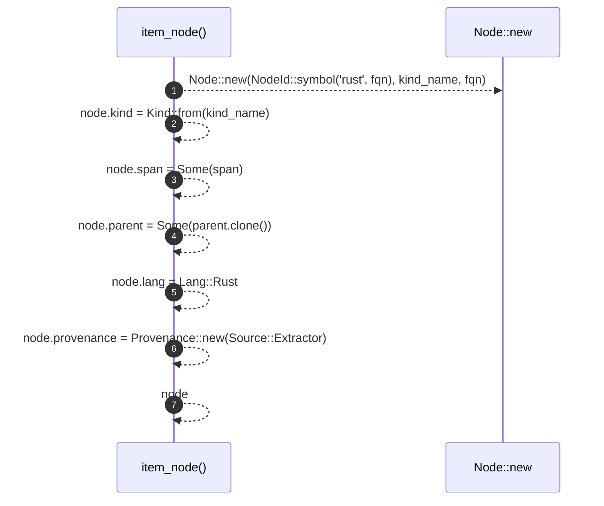

# `robby_extract::item_node`

[Self-model](../README.md) · [robby_extract](index.md)

| | |
|---|---|
| kind | `code.function` |
| signature | `fn item_node(kind_name: &str, fqn: &str, span: Span, parent: &NodeId) -> Node` |
| location | [`crates/robby-extract/src/lib.rs:383`](../../../crates/robby-extract/src/lib.rs#L383) |
| provenance | extractor · confidence 1.00 |

```rust
fn item_node(kind_name: &str, fqn: &str, span: Span, parent: &NodeId) -> Node {
    let mut node = Node::new(NodeId::symbol("rust", fqn), kind_name, fqn);
    node.kind = Kind::from(kind_name);
    node.span = Some(span);
    node.parent = Some(parent.clone());
    node.lang = Lang::Rust;
    node.provenance = Provenance::new(Source::Extractor);
    node
}
```



7 steps · 0 observed · 7 possible only

**Edges**

- calls → [`robby_extract::impl LineIndex::new`](index.md)

