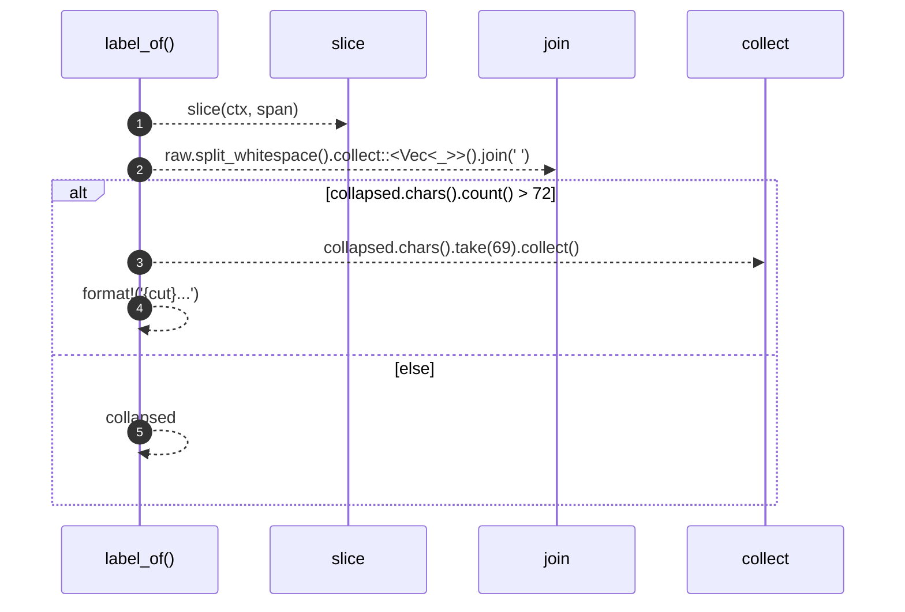

# `robby_extract::label_of`

[Self-model](../README.md) · [robby_extract](index.md)

| | |
|---|---|
| kind | `code.function` |
| signature | `fn label_of(ctx: &Ctx<'_>, span: Span) -> String` |
| location | [`crates/robby-extract/src/lib.rs:530`](../../../crates/robby-extract/src/lib.rs#L530) |
| provenance | extractor · confidence 1.00 |

```rust
fn label_of(ctx: &Ctx<'_>, span: Span) -> String {
    let raw = slice(ctx, span);
    let collapsed = raw.split_whitespace().collect::<Vec<_>>().join(" ");
    if collapsed.chars().count() > 72 {
        let cut: String = collapsed.chars().take(69).collect();
        format!("{cut}...")
    } else {
        collapsed
    }
}
```



5 steps · 0 observed · 5 possible only

**Edges**

- calls → [`robby_extract::slice`](slice.md)

