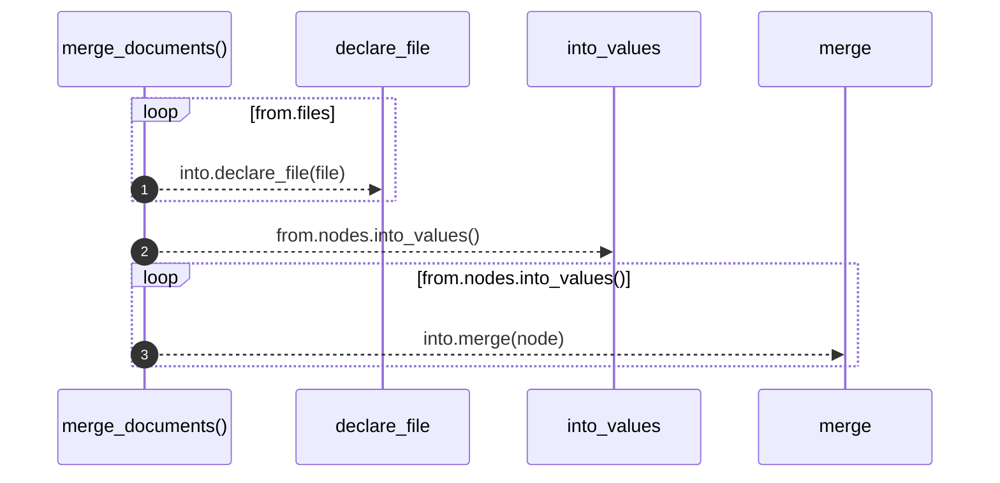

# `robby_extract::merge_documents`

[Self-model](../README.md) · [robby_extract](index.md)

| | |
|---|---|
| kind | `code.function` |
| signature | `fn merge_documents(into: &mut Document, from: Document)` |
| location | [`crates/robby-extract/src/lib.rs:103`](../../../crates/robby-extract/src/lib.rs#L103) |
| provenance | extractor · confidence 1.00 |

```rust
fn merge_documents(into: &mut Document, from: Document) {
    for file in from.files {
        into.declare_file(file);
    }
    for node in from.nodes.into_values() {
        into.merge(node);
    }
}
```



3 steps · 0 observed · 3 possible only

**Edges**

- calls → [`robby_ir::model::impl Document::declare_file`](../robby_ir/model/index.md)
- calls → [`robby_ir::model::impl Document::merge`](../robby_ir/model/index.md)

## References

- calls → [`robby_ir::model`](../robby_ir/model/index.md) — declare_file, merge

## Referenced by

- calls ← [`robby_extract::extract`](extract.md)
- calls ← [`robby_extract::extract_with`](extract-with.md)

