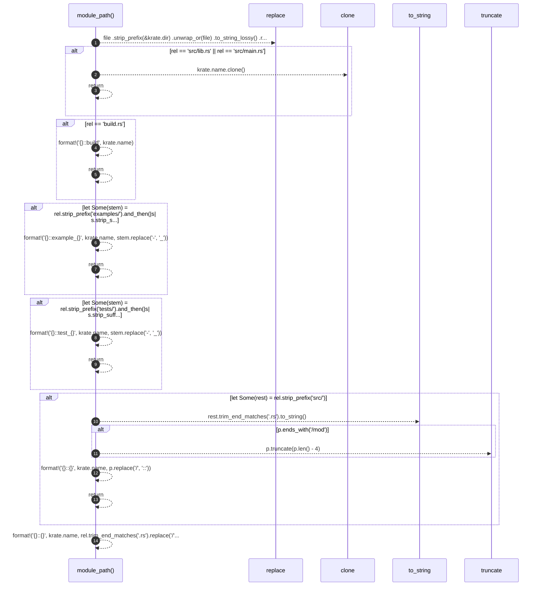

# `robby_extract::module_path`

[Self-model](../README.md) · [robby_extract](index.md)

| | |
|---|---|
| kind | `code.function` |
| signature | `fn module_path(krate: &Krate, file: &Path) -> String` |
| location | [`crates/robby-extract/src/lib.rs:117`](../../../crates/robby-extract/src/lib.rs#L117) |
| provenance | extractor · confidence 1.00 |

```rust
fn module_path(krate: &Krate, file: &Path) -> String {
    let rel = file
        .strip_prefix(&krate.dir)
        .unwrap_or(file)
        .to_string_lossy()
        .replace('\\', "/");

    if rel == "src/lib.rs" || rel == "src/main.rs" {
        return krate.name.clone();
    }
    if rel == "build.rs" {
        return format!("{}::build", krate.name);
    }
    if let Some(stem) = rel.strip_prefix("examples/").and_then(|s| s.strip_suffix(".rs")) {
        return format!("{}::example_{}", krate.name, stem.replace('-', "_"));
    }
    if let Some(stem) = rel.strip_prefix("tests/").and_then(|s| s.strip_suffix(".rs")) {
        return format!("{}::test_{}", krate.name, stem.replace('-', "_"));
    }
    if let Some(rest) = rel.strip_prefix("src/") {
        let mut p = rest.trim_end_matches(".rs").to_string();
        if p.ends_with("/mod") {
            p.truncate(p.len() - 4);
        }
        return format!("{}::{}", krate.name, p.replace('/', "::"));
    }
    format!("{}::{}", krate.name, rel.trim_end_matches(".rs").replace('/', "::"))
}
```



14 steps · 0 observed · 14 possible only

