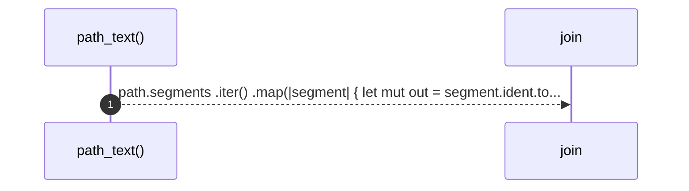

# `robby_extract::path_text`

[Self-model](../README.md) · [robby_extract](index.md)

| | |
|---|---|
| kind | `code.function` |
| signature | `fn path_text(path: &syn::Path) -> String` |
| location | [`crates/robby-extract/src/lib.rs:421`](../../../crates/robby-extract/src/lib.rs#L421) |
| provenance | extractor · confidence 1.00 |

```rust
fn path_text(path: &syn::Path) -> String {
    path.segments
        .iter()
        .map(|segment| {
            let mut out = segment.ident.to_string();
            if let syn::PathArguments::AngleBracketed(args) = &segment.arguments {
                let inner: Vec<String> = args
                    .args
                    .iter()
                    .map(|arg| match arg {
                        syn::GenericArgument::Type(ty) => type_text(ty),
                        syn::GenericArgument::Lifetime(lt) => format!("'{}", lt.ident),
                        _ => "_".to_owned(),
                    })
                    .collect();
                out.push('<');
                out.push_str(&inner.join(", "));
                out.push('>');
            }
            out
        })
        .collect::<Vec<_>>()
        .join("::")
}
```



1 steps · 0 observed · 1 possible only

