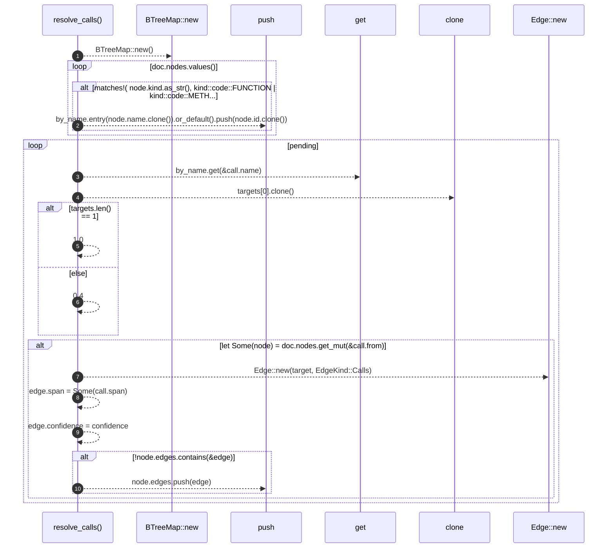

# `robby_extract::resolve_calls`

[Self-model](../README.md) · [robby_extract](index.md)

| | |
|---|---|
| kind | `code.function` |
| signature | `fn resolve_calls(doc: &mut Document, pending: Vec<PendingCall>)` |
| location | [`crates/robby-extract/src/lib.rs:806`](../../../crates/robby-extract/src/lib.rs#L806) |
| provenance | extractor · confidence 1.00 |

```rust
fn resolve_calls(doc: &mut Document, pending: Vec<PendingCall>) {
    let mut by_name: BTreeMap<String, Vec<NodeId>> = BTreeMap::new();
    for node in doc.nodes.values() {
        if matches!(
            node.kind.as_str(),
            kind::code::FUNCTION | kind::code::METHOD
        ) {
            by_name.entry(node.name.clone()).or_default().push(node.id.clone());
        }
    }

    for call in pending {
        let Some(targets) = by_name.get(&call.name) else {
            continue;
        };
        let target = targets[0].clone();
        let confidence = if targets.len() == 1 { 1.0 } else { 0.4 };
        if let Some(node) = doc.nodes.get_mut(&call.from) {
            let mut edge = Edge::new(target, EdgeKind::Calls);
            edge.span = Some(call.span);
            edge.confidence = confidence;
            if !node.edges.contains(&edge) {
                node.edges.push(edge);
            }
        }
    }
}
```



10 steps · 0 observed · 10 possible only

**Edges**

- calls → [`robby_extract::impl LineIndex::new`](index.md)
- calls → [`robby_ir::model::impl Document::get`](../robby_ir/model/index.md)
- calls → [`robby_extract::impl LineIndex::new`](index.md)

