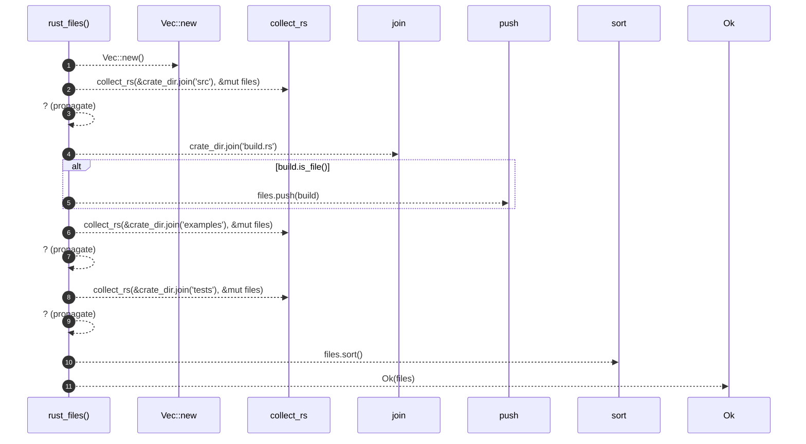

# `robby_extract::rust_files`

[Self-model](../README.md) · [robby_extract](index.md)

| | |
|---|---|
| kind | `code.function` |
| signature | `fn rust_files(crate_dir: &Path) -> Result<Vec<PathBuf>>` |
| location | [`crates/robby-extract/src/lib.rs:86`](../../../crates/robby-extract/src/lib.rs#L86) |
| provenance | extractor · confidence 1.00 |

```rust
fn rust_files(crate_dir: &Path) -> Result<Vec<PathBuf>> {
    let mut files = Vec::new();
    collect_rs(&crate_dir.join("src"), &mut files)?;
    let build = crate_dir.join("build.rs");
    if build.is_file() {
        files.push(build);
    }
    collect_rs(&crate_dir.join("examples"), &mut files)?;
    collect_rs(&crate_dir.join("tests"), &mut files)?;
    files.sort();
    Ok(files)
}
```



11 steps · 0 observed · 11 possible only

**Edges**

- calls → [`robby_extract::impl LineIndex::new`](index.md)
- calls → [`robby_extract::collect_rs`](collect-rs.md)
- calls → [`robby_extract::collect_rs`](collect-rs.md)
- calls → [`robby_extract::collect_rs`](collect-rs.md)

