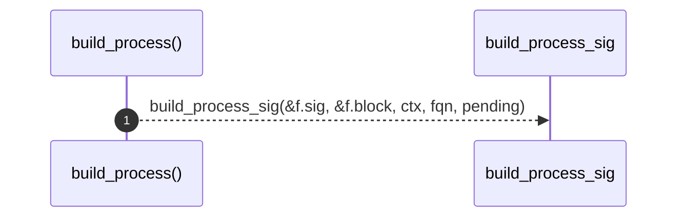

# `robby_extract::rust::build_process`

[Self-model](../../README.md) · [rust](index.md)

| | |
|---|---|
| kind | `code.function` |
| signature | `fn build_process(     f: &syn::ItemFn,     ctx: &Ctx<'_>,     fqn: &str,     pending: &mut Vec<PendingCall>, ) -> Process` |
| location | [`crates/robby-extract/src/rust.rs:537`](../../../../crates/robby-extract/src/rust.rs#L537) |
| provenance | extractor · confidence 1.00 |

```rust
fn build_process(
    f: &syn::ItemFn,
    ctx: &Ctx<'_>,
    fqn: &str,
    pending: &mut Vec<PendingCall>,
) -> Process {
    build_process_sig(&f.sig, &f.block, ctx, fqn, pending)
}
```



1 steps · 0 observed · 1 possible only

**Edges**

- calls → [`robby_extract::rust::build_process_sig`](build-process-sig.md)

## References

- calls → [`robby_extract::rust`](index.md) — build_process_sig

## Referenced by

- calls ← [`robby_extract::rust::walk_items`](walk-items.md)

