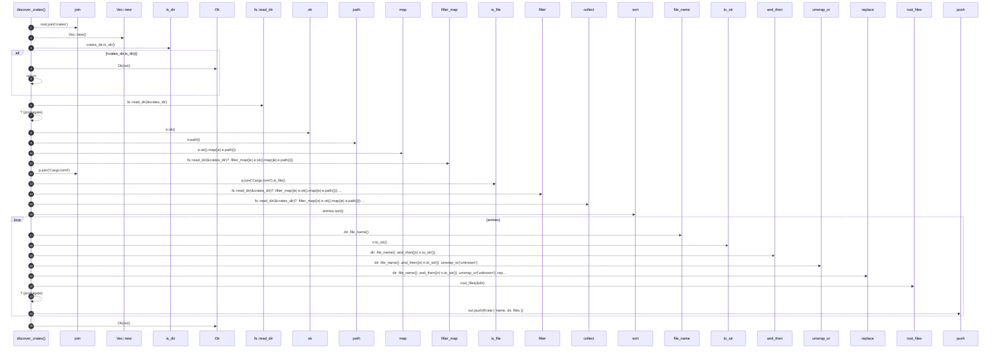

# `robby_extract::rust::discover_crates`

[Self-model](../../README.md) · [rust](index.md)

| | |
|---|---|
| kind | `code.function` |
| signature | `fn discover_crates(root: &Path) -> Result<Vec<Krate>>` |
| location | [`crates/robby-extract/src/rust.rs:47`](../../../../crates/robby-extract/src/rust.rs#L47) |
| provenance | extractor · confidence 1.00 |

```rust
fn discover_crates(root: &Path) -> Result<Vec<Krate>> {
    let crates_dir = root.join("crates");
    let mut out = Vec::new();
    if !crates_dir.is_dir() {
        return Ok(out);
    }

    let mut entries: Vec<PathBuf> = fs::read_dir(&crates_dir)?
        .filter_map(|e| e.ok().map(|e| e.path()))
        .filter(|p| p.join("Cargo.toml").is_file())
        .collect();
    entries.sort();

    for dir in entries {
        let name = dir
            .file_name()
            .and_then(|n| n.to_str())
            .unwrap_or("unknown")
            .replace('-', "_");
        let files = rust_files(&dir)?;
        out.push(Krate { name, dir, files });
    }
    Ok(out)
}
```



25 steps · 0 observed · 25 possible only

**Edges**

- calls → [`robby_extract::rust::impl LineIndex::new`](index.md)
- calls → [`robby_render::view::select::collect`](../../robby_render/view/select/collect.md)
- calls → [`robby_extract::rust::rust_files`](rust-files.md)
- calls → [`robby_render::report::impl Report::push`](../../robby_render/report/index.md)

## References

- calls → [`robby_extract::rust`](index.md) — new, rust_files
- calls → [`robby_render::report`](../../robby_render/report/index.md) — push
- calls → [`robby_render::view::select`](../../robby_render/view/select/index.md) — collect

## Referenced by

- calls ← [`robby_extract::rust::extract`](extract.md)
- calls ← [`robby_extract::rust::source_file_count`](source-file-count.md)

