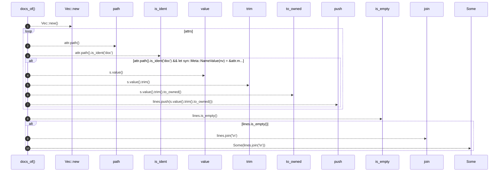

# `robby_extract::rust::docs_of`

[Self-model](../../README.md) · [rust](index.md)

| | |
|---|---|
| kind | `code.function` |
| signature | `fn docs_of<T: Spanned>(_t: &T, attrs: &[syn::Attribute]) -> Option<String>` |
| location | [`crates/robby-extract/src/rust.rs:390`](../../../../crates/robby-extract/src/rust.rs#L390) |
| provenance | extractor · confidence 1.00 |

```rust
fn docs_of<T: Spanned>(_t: &T, attrs: &[syn::Attribute]) -> Option<String> {
    let mut lines = Vec::new();
    for attr in attrs {
        if attr.path().is_ident("doc")
            && let syn::Meta::NameValue(nv) = &attr.meta
            && let syn::Expr::Lit(syn::ExprLit {
                lit: syn::Lit::Str(s),
                ..
            }) = &nv.value
        {
            lines.push(s.value().trim().to_owned());
        }
    }
    if lines.is_empty() {
        None
    } else {
        Some(lines.join("\n"))
    }
}
```



10 steps · 0 observed · 10 possible only

**Edges**

- calls → [`robby_extract::rust::impl LineIndex::new`](index.md)
- calls → [`robby_render::report::impl Report::push`](../../robby_render/report/index.md)
- calls → [`robby_ir::span::impl Span::is_empty`](../../robby_ir/span/index.md)

## References

- calls → [`robby_extract::rust`](index.md) — new
- calls → [`robby_ir::span`](../../robby_ir/span/index.md) — is_empty
- calls → [`robby_render::report`](../../robby_render/report/index.md) — push

## Referenced by

- calls ← [`robby_extract::rust::walk_items`](walk-items.md)

