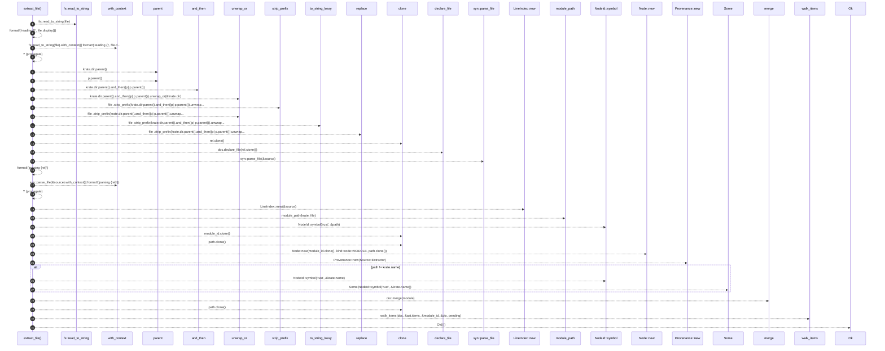

# `robby_extract::rust::extract_file`

[Self-model](../../README.md) · [rust](index.md)

| | |
|---|---|
| kind | `code.function` |
| signature | `fn extract_file(     doc: &mut Document,     krate: &Krate,     file: &Path,     pending: &mut Vec<PendingCall>, ) -> Result<()>` |
| location | [`crates/robby-extract/src/rust.rs:132`](../../../../crates/robby-extract/src/rust.rs#L132) |
| provenance | extractor · confidence 1.00 |

```rust
fn extract_file(
    doc: &mut Document,
    krate: &Krate,
    file: &Path,
    pending: &mut Vec<PendingCall>,
) -> Result<()> {
    let source = fs::read_to_string(file).with_context(|| format!("reading {}", file.display()))?;
    let rel = file
        .strip_prefix(krate.dir.parent().and_then(|p| p.parent()).unwrap_or(&krate.dir))
        .unwrap_or(file)
        .to_string_lossy()
        .replace('\\', "/");

    doc.declare_file(rel.clone());

    let ast = syn::parse_file(&source).with_context(|| format!("parsing {rel}"))?;
    let index = LineIndex::new(&source);
    let path = module_path(krate, file);
    let module_id = NodeId::symbol("rust", &path);

    // File-backed modules hang off their crate so the document has one root per
    // crate. A `mod foo;` declaration may already have set a deeper parent; the
    // merge keeps whatever is there.
    let mut module = Node::new(module_id.clone(), kind::code::MODULE, path.clone());
    module.provenance = Provenance::new(Source::Extractor);
    if path != krate.name {
        module.parent = Some(NodeId::symbol("rust", &krate.name));
    }
    doc.merge(module);

    let ctx = Ctx {
        file: &rel,
        source: &source,
        index: &index,
        module: path.clone(),
    };
    walk_items(doc, &ast.items, &module_id, &ctx, pending);
    Ok(())
}
```



31 steps · 0 observed · 31 possible only

**Edges**

- calls → [`robby_ir::model::impl Document::declare_file`](../../robby_ir/model/index.md)
- calls → [`robby_extract::rust::impl LineIndex::new`](index.md)
- calls → [`robby_extract::rust::module_path`](module-path.md)
- calls → [`robby_ir::model::impl NodeId::symbol`](../../robby_ir/model/index.md)
- calls → [`robby_extract::rust::impl LineIndex::new`](index.md)
- calls → [`robby_extract::rust::impl LineIndex::new`](index.md)
- calls → [`robby_ir::model::impl NodeId::symbol`](../../robby_ir/model/index.md)
- calls → [`robby_ir::model::impl Document::merge`](../../robby_ir/model/index.md)
- calls → [`robby_extract::rust::walk_items`](walk-items.md)

## References

- calls → [`robby_extract::rust`](index.md) — module_path, new, walk_items
- calls → [`robby_ir::model`](../../robby_ir/model/index.md) — declare_file, merge, symbol

## Referenced by

- calls ← [`robby_extract::rust::extract`](extract.md)

