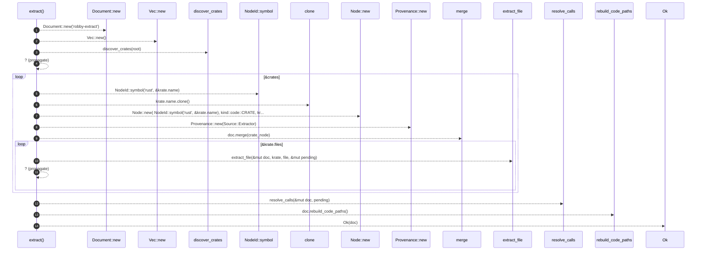

# `robby_extract::rust::extract`

[Self-model](../../README.md) · [rust](index.md)

| | |
|---|---|
| kind | `code.function` |
| signature | `fn extract(root: &Path) -> Result<Document>` |
| location | [`crates/robby-extract/src/rust.rs:16`](../../../../crates/robby-extract/src/rust.rs#L16) |
| provenance | extractor · confidence 1.00 |

> Extract a document describing every Rust crate under `<root>/crates`.

```rust
/// Extract a document describing every Rust crate under `<root>/crates`.
pub(crate) fn extract(root: &Path) -> Result<Document> {
    let mut doc = Document::new("robby-extract");
    let mut pending: Vec<PendingCall> = Vec::new();

    let crates = discover_crates(root)?;
    for krate in &crates {
        let mut crate_node = Node::new(
            NodeId::symbol("rust", &krate.name),
            kind::code::CRATE,
            krate.name.clone(),
        );
        crate_node.provenance = Provenance::new(Source::Extractor);
        doc.merge(crate_node);

        for file in &krate.files {
            extract_file(&mut doc, krate, file, &mut pending)?;
        }
    }

    resolve_calls(&mut doc, pending);
    doc.rebuild_code_paths();
    Ok(doc)
}
```



14 steps · 0 observed · 14 possible only

**Edges**

- calls → [`robby_extract::rust::impl LineIndex::new`](index.md)
- calls → [`robby_extract::rust::impl LineIndex::new`](index.md)
- calls → [`robby_extract::rust::discover_crates`](discover-crates.md)
- calls → [`robby_ir::model::impl NodeId::symbol`](../../robby_ir/model/index.md)
- calls → [`robby_extract::rust::impl LineIndex::new`](index.md)
- calls → [`robby_extract::rust::impl LineIndex::new`](index.md)
- calls → [`robby_ir::model::impl Document::merge`](../../robby_ir/model/index.md)
- calls → [`robby_extract::rust::extract_file`](extract-file.md)
- calls → [`robby_extract::rust::resolve_calls`](resolve-calls.md)
- calls → [`robby_ir::model::impl Document::rebuild_code_paths`](../../robby_ir/model/index.md)

## References

- calls → [`robby_extract::rust`](index.md) — discover_crates, extract_file, new, resolve_calls
- calls → [`robby_ir::model`](../../robby_ir/model/index.md) — merge, rebuild_code_paths, symbol

