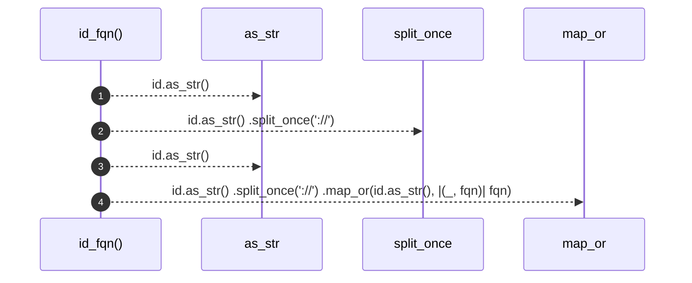

# `robby_extract::rust::id_fqn`

[Self-model](../../README.md) · [rust](index.md)

| | |
|---|---|
| kind | `code.function` |
| signature | `fn id_fqn(id: &NodeId) -> &str` |
| location | [`crates/robby-extract/src/rust.rs:941`](../../../../crates/robby-extract/src/rust.rs#L941) |
| provenance | extractor · confidence 1.00 |

```rust
fn id_fqn(id: &NodeId) -> &str {
    id.as_str()
        .split_once("://")
        .map_or(id.as_str(), |(_, fqn)| fqn)
}
```



4 steps · 0 observed · 4 possible only

**Edges**

- calls → [`robby_ir::kind::impl Kind::as_str`](../../robby_ir/kind/index.md)
- calls → [`robby_ir::kind::impl Kind::as_str`](../../robby_ir/kind/index.md)

## References

- calls → [`robby_ir::kind`](../../robby_ir/kind/index.md) — as_str

## Referenced by

- calls ← [`robby_extract::rust::pick_call_target`](pick-call-target.md)

