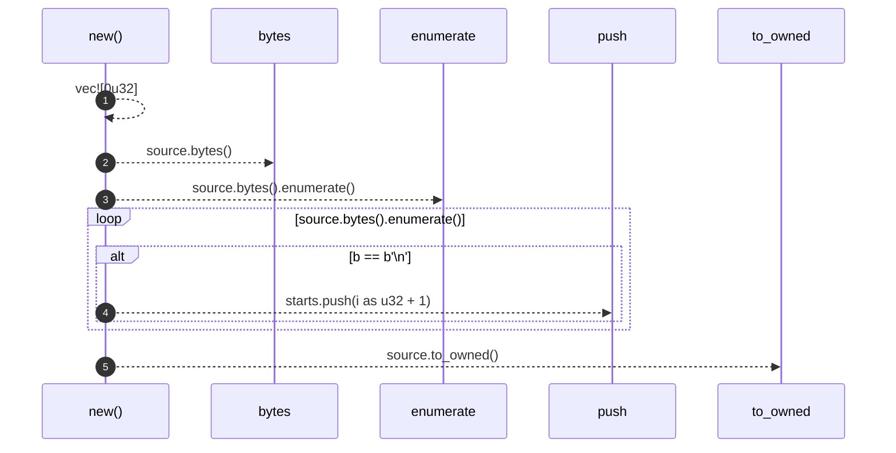
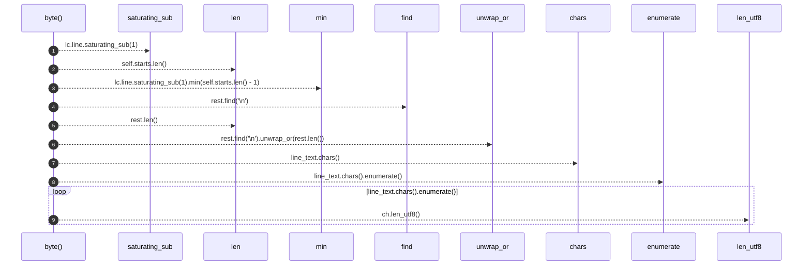

# `robby_extract::rust::impl LineIndex`

[Self-model](../../README.md) · [rust](index.md)

| | |
|---|---|
| kind | `code.impl` |
| location | [`crates/robby-extract/src/rust.rs:471`](../../../../crates/robby-extract/src/rust.rs#L471) |
| provenance | extractor · confidence 1.00 |

```rust
impl LineIndex {
    pub fn new(source: &str) -> Self {
        let mut starts = vec![0u32];
        for (i, b) in source.bytes().enumerate() {
            if b == b'\n' {
                starts.push(i as u32 + 1);
            }
        }
        Self {
            starts,
            source: source.to_owned(),
        }
    }

    pub fn byte(&self, lc: LineColumn) -> u32 {
        let line = lc.line.saturating_sub(1).min(self.starts.len() - 1);
        let start = self.starts[line] as usize;
        let rest = &self.source[start..];
        let end = rest.find('\n').unwrap_or(rest.len());
        let line_text = &rest[..end];
        let mut byte = start;
        for (i, ch) in line_text.chars().enumerate() {
            if i >= lc.column {
                break;
            }
            byte += ch.len_utf8();
        }
        byte as u32
    }
}
```

## References

- calls → [`robby_render::report`](../../robby_render/report/index.md) — push

## Referenced by

- calls ← [`robby_extract::rust::build_process_sig`](build-process-sig.md)
- calls ← [`robby_extract::rust::discover_crates`](discover-crates.md)
- calls ← [`robby_extract::rust::docs_of`](docs-of.md)
- calls ← [`robby_extract::rust::extract`](extract.md)
- calls ← [`robby_extract::rust::extract_file`](extract-file.md)
- calls ← [`robby_extract::rust::item_node`](item-node.md)
- calls ← [`robby_extract::rust::line_index_handles_non_ascii`](tests/line-index-handles-non-ascii.md)
- calls ← [`robby_extract::rust::resolve_calls`](resolve-calls.md)
- calls ← [`robby_extract::rust::rust_files`](rust-files.md)
- calls ← [`robby_extract::rust::span_of`](span-of.md)
- calls ← [`robby_extract::test_extract::the_workspace_is_fully_covered`](../test_extract/the-workspace-is-fully-covered.md)
- calls ← [`robby_extract::test_typescript::typescript_fixture_is_fully_covered`](../test_typescript/typescript-fixture-is-fully-covered.md)
- calls ← [`robby_extract::typescript::build_function_process`](../typescript/build-function-process.md)
- calls ← [`robby_extract::typescript::discover_packages`](../typescript/discover-packages.md)
- calls ← [`robby_extract::typescript::emit_class`](../typescript/emit-class.md)
- calls ← [`robby_extract::typescript::emit_import`](../typescript/emit-import.md)
- calls ← [`robby_extract::typescript::emit_interface`](../typescript/emit-interface.md)
- calls ← [`robby_extract::typescript::emit_variable`](../typescript/emit-variable.md)
- calls ← [`robby_extract::typescript::extract`](../typescript/extract.md)
- calls ← [`robby_extract::typescript::extract_file`](../typescript/extract-file.md)
- calls ← [`robby_extract::typescript::item_node`](../typescript/item-node.md)
- calls ← [`robby_extract::typescript::oxc_span`](../typescript/oxc-span.md)
- calls ← [`robby_extract::typescript::push_step`](../typescript/push-step.md)
- calls ← [`robby_extract::typescript::resolve_calls`](../typescript/resolve-calls.md)
- calls ← [`robby_extract::typescript::resolve_relative_import`](../typescript/resolve-relative-import.md)
- calls ← [`robby_extract::typescript::ts_files`](../typescript/ts-files.md)

### `new`

| | |
|---|---|
| kind | `code.method` |
| signature | `fn new(1)` |
| location | [`crates/robby-extract/src/rust.rs:472`](../../../../crates/robby-extract/src/rust.rs#L472) |
| provenance | extractor · confidence 1.00 |

```rust
pub fn new(source: &str) -> Self {
        let mut starts = vec![0u32];
        for (i, b) in source.bytes().enumerate() {
            if b == b'\n' {
                starts.push(i as u32 + 1);
            }
        }
        Self {
            starts,
            source: source.to_owned(),
        }
    }
```



5 steps · 0 observed · 5 possible only

**Edges**

- calls → [`robby_render::report::impl Report::push`](../../robby_render/report/index.md)

### `byte`

| | |
|---|---|
| kind | `code.method` |
| signature | `fn byte(2)` |
| location | [`crates/robby-extract/src/rust.rs:485`](../../../../crates/robby-extract/src/rust.rs#L485) |
| provenance | extractor · confidence 1.00 |

```rust
pub fn byte(&self, lc: LineColumn) -> u32 {
        let line = lc.line.saturating_sub(1).min(self.starts.len() - 1);
        let start = self.starts[line] as usize;
        let rest = &self.source[start..];
        let end = rest.find('\n').unwrap_or(rest.len());
        let line_text = &rest[..end];
        let mut byte = start;
        for (i, ch) in line_text.chars().enumerate() {
            if i >= lc.column {
                break;
            }
            byte += ch.len_utf8();
        }
        byte as u32
    }
```



9 steps · 0 observed · 9 possible only

