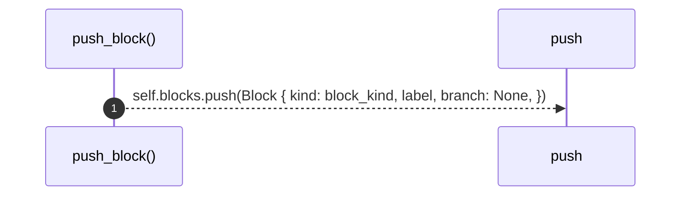
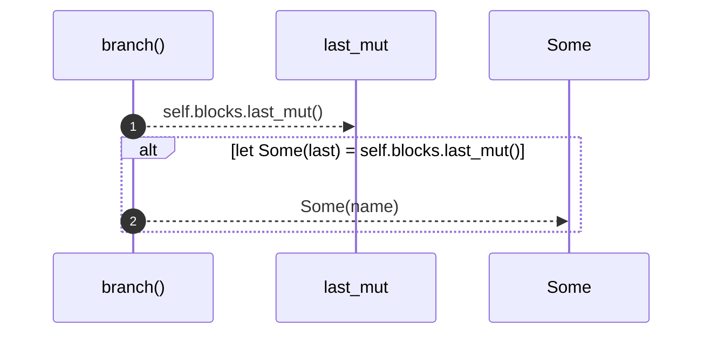
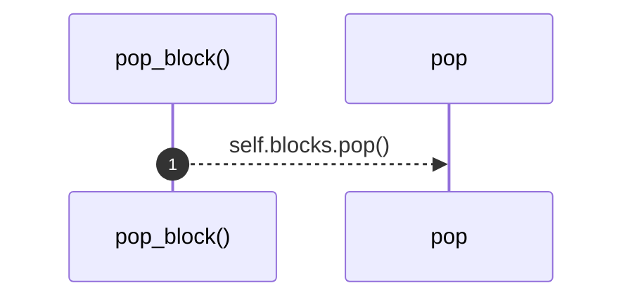

# `robby_extract::rust::impl ProcBuilder<'_, '_>`

[Self-model](../../README.md) · [rust](index.md)

| | |
|---|---|
| kind | `code.impl` |
| location | [`crates/robby-extract/src/rust.rs:584`](../../../../crates/robby-extract/src/rust.rs#L584) |
| provenance | extractor · confidence 1.00 |

```rust
impl ProcBuilder<'_, '_> {
    fn emit(&mut self, to: &str, label: String, step_kind: StepKind, span: Span) {
        let from = sanitize(&self.me);
        let to_id = sanitize(to);
        if from == to_id {
            self.process.participant(
                to_id.clone(),
                self.me.clone(),
                Kind::from(kind::code::FUNCTION),
            );
        } else {
            self.process.participant(
                to_id.clone(),
                to.to_owned(),
                Kind::from(kind::code::FUNCTION),
            );
        }
        self.process.step(Step {
            from,
            to: to_id,
            label,
            kind: step_kind,
            observed: false,
            span: Some(span),
            blocks: self.blocks.clone(),
        });
    }

    fn push_block(&mut self, block_kind: BlockKind, label: String) {
        self.blocks.push(Block {
            kind: block_kind,
            label,
            branch: None,
        });
    }

    fn branch(&mut self, name: String) {
        if let Some(last) = self.blocks.last_mut() {
            last.branch = Some(name);
        }
    }

    fn pop_block(&mut self) {
        self.blocks.pop();
    }
}
```

## References

- calls → [`robby_extract::rust`](index.md) — sanitize
- calls → [`robby_ir::kind`](../../robby_ir/kind/index.md) — from
- calls → [`robby_ir::process`](../../robby_ir/process/index.md) — participant
- calls → [`robby_render::report`](../../robby_render/report/index.md) — push
- calls → [`robby_render::test_render`](../../robby_render/test_render/index.md) — step

## Referenced by

- calls ← [`robby_extract::rust::walk_expr`](walk-expr.md)
- calls ← [`robby_extract::rust::walk_stmts`](walk-stmts.md)

### `emit`

| | |
|---|---|
| kind | `code.method` |
| signature | `fn emit(5)` |
| location | [`crates/robby-extract/src/rust.rs:585`](../../../../crates/robby-extract/src/rust.rs#L585) |
| provenance | extractor · confidence 1.00 |

```rust
fn emit(&mut self, to: &str, label: String, step_kind: StepKind, span: Span) {
        let from = sanitize(&self.me);
        let to_id = sanitize(to);
        if from == to_id {
            self.process.participant(
                to_id.clone(),
                self.me.clone(),
                Kind::from(kind::code::FUNCTION),
            );
        } else {
            self.process.participant(
                to_id.clone(),
                to.to_owned(),
                Kind::from(kind::code::FUNCTION),
            );
        }
        self.process.step(Step {
            from,
            to: to_id,
            label,
            kind: step_kind,
            observed: false,
            span: Some(span),
            blocks: self.blocks.clone(),
        });
    }
```

```mermaid
sequenceDiagram
    autonumber
    participant emit as emit()
    participant sanitize as sanitize
    participant clone as clone
    participant Kind__from as Kind::from
    participant participant as participant
    participant to_owned as to_owned
    participant Some as Some
    participant step as step
    emit-->>sanitize: sanitize(&self.me)
    emit-->>sanitize: sanitize(to)
    alt from == to_id
    emit-->>clone: to_id.clone()
    emit-->>clone: self.me.clone()
    emit-->>Kind__from: Kind::from(kind::code::FUNCTION)
    emit-->>participant: self.process.participant( to_id.clone(), self.me.clone(), Kind::from(...
    else else
    emit-->>clone: to_id.clone()
    emit-->>to_owned: to.to_owned()
    emit-->>Kind__from: Kind::from(kind::code::FUNCTION)
    emit-->>participant: self.process.participant( to_id.clone(), to.to_owned(), Kind::from(ki...
    end
    emit-->>Some: Some(span)
    emit-->>clone: self.blocks.clone()
    emit-->>step: self.process.step(Step { from, to: to_id, label, kind: step_kind, obs...
```

13 steps · 0 observed · 13 possible only

**Edges**

- calls → [`robby_extract::rust::sanitize`](sanitize.md)
- calls → [`robby_extract::rust::sanitize`](sanitize.md)
- calls → [`robby_ir::kind::impl From<&str> for Kind::from`](../../robby_ir/kind/index.md)
- calls → [`robby_ir::process::impl Process::participant`](../../robby_ir/process/index.md)
- calls → [`robby_ir::kind::impl From<&str> for Kind::from`](../../robby_ir/kind/index.md)
- calls → [`robby_ir::process::impl Process::participant`](../../robby_ir/process/index.md)
- calls → [`robby_render::test_render::step`](../../robby_render/test_render/step.md)

### `push_block`

| | |
|---|---|
| kind | `code.method` |
| signature | `fn push_block(3)` |
| location | [`crates/robby-extract/src/rust.rs:612`](../../../../crates/robby-extract/src/rust.rs#L612) |
| provenance | extractor · confidence 1.00 |

```rust
fn push_block(&mut self, block_kind: BlockKind, label: String) {
        self.blocks.push(Block {
            kind: block_kind,
            label,
            branch: None,
        });
    }
```



1 steps · 0 observed · 1 possible only

**Edges**

- calls → [`robby_render::report::impl Report::push`](../../robby_render/report/index.md)

### `branch`

| | |
|---|---|
| kind | `code.method` |
| signature | `fn branch(2)` |
| location | [`crates/robby-extract/src/rust.rs:620`](../../../../crates/robby-extract/src/rust.rs#L620) |
| provenance | extractor · confidence 1.00 |

```rust
fn branch(&mut self, name: String) {
        if let Some(last) = self.blocks.last_mut() {
            last.branch = Some(name);
        }
    }
```



2 steps · 0 observed · 2 possible only

### `pop_block`

| | |
|---|---|
| kind | `code.method` |
| signature | `fn pop_block(1)` |
| location | [`crates/robby-extract/src/rust.rs:626`](../../../../crates/robby-extract/src/rust.rs#L626) |
| provenance | extractor · confidence 1.00 |

```rust
fn pop_block(&mut self) {
        self.blocks.pop();
    }
```



1 steps · 0 observed · 1 possible only

