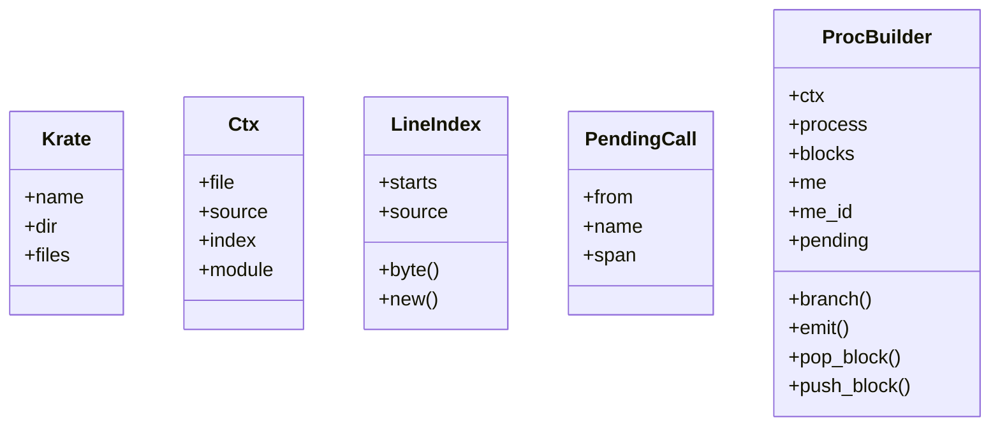
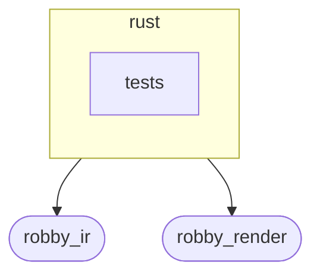

# `robby_extract::rust`

[Self-model](../../README.md) · [robby_extract](../index.md)

| | |
|---|---|
| kind | `code.module` |
| declared at | [`crates/robby-extract/src/lib.rs:10`](../../../../crates/robby-extract/src/lib.rs#L10) |
| provenance | extractor · confidence 1.00 |
| nodes | 72 |

## Types



## Package diagram



## Module coupling

```mermaid
flowchart TB
    subgraph n_a95c010a8299da11["rust"]
        direction TB
        n_00e670e0fe5e368a["branch"]
        n_2e869108f4860bed["build_process"]
        n_0f65d8e0fcc6247f["build_process_sig"]
        n_7aed70fa5f530043["byte"]
        n_e0aff4d7ad1207be["callee_display"]
        n_7c0adbff2a4d8453["callee_name"]
        n_679aecb6a44a0b7d["collect_rs"]
        n_fa1271699af1636f["discover_crates"]
        n_27aab962727b45b6["docs_of"]
        n_0b7fb84245603f15["emit"]
        n_1bde06ec58273cea["extract"]
        n_ef635844bddcf7e1["extract_file"]
        n_d28472b55fee0f76["id_fqn"]
        n_650659dfe62a65ef["item_node"]
        n_892332fc0b489f53["label_of"]
        n_d125c18de590c914["line_index_handles_non_ascii"]
        n_be96122d6baee981["module_path"]
        n_245831ade8589906["module_prefix"]
        n_3d45ae7c14c050a5["new"]
        n_7598b208a83997b8["path_text"]
        n_1e1aa9caf8f26a21["pick_call_prefers_same_module"]
        n_b5b84581b05cb76f["pick_call_target"]
        n_69f0a9313046642f["pop_block"]
        n_bd9191c7b36f1f58["push_block"]
        n_ccdbd1cda9cd2829["resolve_calls"]
        n_22e992d880112533["rust_files"]
        n_23c84b2d0e41cc06["sanitize"]
        n_5f193ee8abca963c["shared_module_score"]
        n_cfd4e690409a9c13["signature_of"]
        n_c0f769058db96d25["slice"]
        n_6f4ea505bb50f03f["source_file_count"]
        n_55b1c39de138eeff["span_of"]
        n_d50c0ac601bc59b9["type_text"]
        n_e2da56648b8aafaa["walk_expr"]
        n_494ba2a3fa438ab3["walk_items"]
        n_e0f46f8e875851fc["walk_stmts"]
    end
    n_0b7fb84245603f15 -->|"2"| n_23c84b2d0e41cc06
    n_0f65d8e0fcc6247f --> n_23c84b2d0e41cc06
    n_0f65d8e0fcc6247f -->|"2"| n_3d45ae7c14c050a5
    n_0f65d8e0fcc6247f --> n_e0f46f8e875851fc
    n_1bde06ec58273cea -->|"4"| n_3d45ae7c14c050a5
    n_1bde06ec58273cea --> n_ccdbd1cda9cd2829
    n_1bde06ec58273cea --> n_ef635844bddcf7e1
    n_1bde06ec58273cea --> n_fa1271699af1636f
    n_1e1aa9caf8f26a21 --> n_b5b84581b05cb76f
    n_22e992d880112533 --> n_3d45ae7c14c050a5
    n_22e992d880112533 -->|"3"| n_679aecb6a44a0b7d
    n_27aab962727b45b6 --> n_3d45ae7c14c050a5
    n_2e869108f4860bed --> n_0f65d8e0fcc6247f
    n_494ba2a3fa438ab3 --> n_0f65d8e0fcc6247f
    n_494ba2a3fa438ab3 -->|"5"| n_27aab962727b45b6
    n_494ba2a3fa438ab3 --> n_2e869108f4860bed
    n_494ba2a3fa438ab3 -->|"7"| n_55b1c39de138eeff
    n_494ba2a3fa438ab3 -->|"22"| n_650659dfe62a65ef
    n_494ba2a3fa438ab3 --> n_cfd4e690409a9c13
    n_494ba2a3fa438ab3 --> n_d50c0ac601bc59b9
    n_55b1c39de138eeff --> n_3d45ae7c14c050a5
    n_55b1c39de138eeff -->|"2"| n_7aed70fa5f530043
    n_650659dfe62a65ef -->|"2"| n_3d45ae7c14c050a5
    n_6f4ea505bb50f03f --> n_fa1271699af1636f
    n_7598b208a83997b8 -.->|"1 circular"| n_d50c0ac601bc59b9
    n_892332fc0b489f53 --> n_c0f769058db96d25
    n_b5b84581b05cb76f -->|"2"| n_245831ade8589906
    n_b5b84581b05cb76f --> n_5f193ee8abca963c
    n_b5b84581b05cb76f --> n_d28472b55fee0f76
    n_ccdbd1cda9cd2829 -->|"2"| n_3d45ae7c14c050a5
    n_ccdbd1cda9cd2829 --> n_b5b84581b05cb76f
    n_cfd4e690409a9c13 --> n_55b1c39de138eeff
    n_cfd4e690409a9c13 --> n_c0f769058db96d25
    n_d125c18de590c914 --> n_3d45ae7c14c050a5
    n_d125c18de590c914 -->|"2"| n_7aed70fa5f530043
    n_d50c0ac601bc59b9 -.->|"1 circular"| n_7598b208a83997b8
    n_e0aff4d7ad1207be --> n_7598b208a83997b8
    n_e0aff4d7ad1207be --> n_7c0adbff2a4d8453
    n_e0f46f8e875851fc -->|"3"| n_0b7fb84245603f15
    n_e0f46f8e875851fc -->|"3"| n_55b1c39de138eeff
    n_e0f46f8e875851fc -->|"3"| n_892332fc0b489f53
    n_e0f46f8e875851fc -.->|"2 circular"| n_e2da56648b8aafaa
    n_e2da56648b8aafaa -->|"2"| n_00e670e0fe5e368a
    n_e2da56648b8aafaa -->|"6"| n_0b7fb84245603f15
    n_e2da56648b8aafaa -->|"11"| n_55b1c39de138eeff
    n_e2da56648b8aafaa -->|"5"| n_69f0a9313046642f
    n_e2da56648b8aafaa --> n_7c0adbff2a4d8453
    n_e2da56648b8aafaa -->|"8"| n_892332fc0b489f53
    n_e2da56648b8aafaa -->|"5"| n_bd9191c7b36f1f58
    n_e2da56648b8aafaa --> n_e0aff4d7ad1207be
    n_e2da56648b8aafaa -.->|"9 circular"| n_e0f46f8e875851fc
    n_ef635844bddcf7e1 -->|"3"| n_3d45ae7c14c050a5
    n_ef635844bddcf7e1 --> n_494ba2a3fa438ab3
    n_ef635844bddcf7e1 --> n_be96122d6baee981
    n_fa1271699af1636f --> n_22e992d880112533
    n_fa1271699af1636f --> n_3d45ae7c14c050a5
```



## Dependency matrix

| | rust | tests | robby_ir | robby_render |
|---|---:|---:|---:|---:|
| **rust** | · | | 60 | 25 |
| **tests** | | · | | |
| **robby_ir** | | | · | |
| **robby_render** | | | | · |

## Comments

- `crates/robby-extract/src/rust.rs:16:1` (docs, `robby_extract::rust::extract`): "Extract a document describing every Rust crate under `<root>/crates`."
  ```
  /// Extract a document describing every Rust crate under `<root>/crates`.
  pub(crate) fn extract(root: &Path) -> Result<Document> {
      let mut doc = Document::new("robby-extract");
      let mut pending: Vec<PendingCall> = Vec::new();
  
      let crates = discover_crates(root)?;
      for krate in &crates {
          let mut crate_node = Node::new(
              NodeId::symbol("rust", &krate.name),
              kind::code::CRATE,
              krate.name.clone(),
          );
          crate_node.provenance = Provenance::new(Source::Extractor);
          doc.merge(crate_node);
  
          for file in &krate.files {
              extract_file(&mut doc, krate, file, &mut pending)?;
          }
      }
  
      resolve_calls(&mut doc, pending);
      doc.rebuild_code_paths();
      Ok(doc)
  }
  ```
- `crates/robby-extract/src/rust.rs:435:1` (docs, `robby_extract::rust::type_text`): "Render a type just well enough to disambiguate impl blocks. `impl From<&str> for Kind` and `impl From<String> for Kind`…"
  ```
  /// Render a type just well enough to disambiguate impl blocks.
  ///
  /// `impl From<&str> for Kind` and `impl From<String> for Kind` must not collide,
  /// so generic arguments are part of the identity.
  fn type_text(ty: &Type) -> String {
      match ty {
          Type::Path(p) => path_text(&p.path),
          Type::Reference(r) => format!(
              "&{}{}",
              if r.mutability.is_some() { "mut " } else { "" },
              type_text(&r.elem)
          ),
          Type::Tuple(t) => format!(
              "({})",
              t.elems.iter().map(type_text).collect::<Vec<_>>().join(", ")
          ),
          Type::Slice(s) => format!("[{}]", type_text(&s.elem)),
          Type::Array(a) => format!("[{}; _]", type_text(&a.elem)),
          Type::Ptr(p) => format!("*{}", type_text(&p.elem)),
          Type::Paren(p) => type_text(&p.elem),
          Type::Group(g) => type_text(&g.elem),
          _ => "_".to_owned(),
      }
  }
  ```
- `crates/robby-extract/src/rust.rs:464:1` (docs, `robby_extract::rust::LineIndex`): "Converts proc-macro2 line/column positions into byte offsets. `proc-macro2`'s `span-locations` reports columns as chara…"
  ```
  /// Converts proc-macro2 line/column positions into byte offsets.
  ///
  /// `proc-macro2`'s `span-locations` reports columns as character offsets within
  /// the line, so the conversion walks chars rather than bytes. This is what makes
  /// coverage exact on files containing non-ASCII identifiers or comments.
  pub(crate) struct LineIndex {
      starts: Vec<u32>,
      source: String,
  }
  ```
- `crates/robby-extract/src/rust.rs:828:1` (docs, `robby_extract::rust::callee_display`): "The readable callee, including its module path: `Document::new`."
  ```
  /// The readable callee, including its module path: `Document::new`.
  fn callee_display(func: &Expr) -> String {
      match func {
          Expr::Path(p) => path_text(&p.path),
          _ => callee_name(func),
      }
  }
  ```
- `crates/robby-extract/src/rust.rs:836:1` (docs, `robby_extract::rust::callee_name`): "The last segment, used to match against known items."
  ```
  /// The last segment, used to match against known items.
  fn callee_name(func: &Expr) -> String {
      match func {
          Expr::Path(p) => p
              .path
              .segments
              .last()
              .map_or_else(|| "call".to_owned(), |s| s.ident.to_string()),
          Expr::Field(f) => match &f.member {
              syn::Member::Named(n) => n.to_string(),
              syn::Member::Unnamed(i) => format!("field{}", i.index),
          },
          _ => "call".to_owned(),
      }
  }
  ```
- `crates/robby-extract/src/rust.rs:908:1` (docs, `robby_extract::rust::pick_call_target`): "Prefer the callee in the same module as the caller; then longest shared module prefix; then shortest FQN (sibling over …"
  ```
  /// Prefer the callee in the same module as the caller; then longest shared
  /// module prefix; then shortest FQN (sibling over nested crate paths).
  fn pick_call_target(caller_fqn: &str, targets: &[NodeId]) -> (NodeId, f32) {
      if targets.len() == 1 {
          return (targets[0].clone(), 1.0);
      }
      let caller_mod = module_prefix(caller_fqn);
      let mut ranked: Vec<(i32, i32, usize, &NodeId)> = targets
          .iter()
          .map(|target| {
              let target_fqn = id_fqn(target);
              let target_mod = module_prefix(target_fqn);
              let exact = i32::from(target_mod == caller_mod);
              let shared = shared_module_score(caller_mod, target_mod) as i32;
              // Shorter FQN wins ties (crate::run over crate::nested::run).
              let len = target_fqn.len();
              (-exact, -shared, len, target)
          })
          .collect();
      ranked.sort();
      let best = ranked[0].3;
      let exact = ranked[0].0 == -1;
      let shared = -ranked[0].1;
      let confidence = if exact {
          0.95
      } else if shared > 0 {
          0.7
      } else {
          0.4
      };
      (best.clone(), confidence)
  }
  ```
- `crates/robby-extract/src/rust.rs:961:1` (docs, `robby_extract::rust::source_file_count`): "Count of `.rs` files the extractor considers part of the workspace."
  ```
  /// Count of `.rs` files the extractor considers part of the workspace.
  pub(crate) fn source_file_count(root: &Path) -> Result<usize> {
      Ok(discover_crates(root)?.iter().map(|k| k.files.len()).sum())
  }
  ```
## References

- calls → [`robby_ir::kind`](../../robby_ir/kind/index.md) — as_str, from
- calls → [`robby_ir::model`](../../robby_ir/model/index.md) — 5 items
- calls → [`robby_ir::process`](../../robby_ir/process/index.md) — participant
- calls → [`robby_ir::run`](../../robby_ir/run/index.md) — get
- calls → [`robby_ir::span`](../../robby_ir/span/index.md) — is_empty
- calls → [`robby_ir::test_coverage`](../../robby_ir/test_coverage/index.md) — span
- calls → [`robby_render::report`](../../robby_render/report/index.md) — push
- calls → [`robby_render::test_render`](../../robby_render/test_render/index.md) — step
- calls → [`robby_render::view::scene`](../../robby_render/view/scene/index.md) — contains
- calls → [`robby_render::view::select`](../../robby_render/view/select/index.md) — collect

## Referenced by

- calls ← [`robby_extract::test_extract::the_workspace_is_fully_covered`](../test_extract/the-workspace-is-fully-covered.md)
- calls ← [`robby_extract::test_typescript::typescript_fixture_is_fully_covered`](../test_typescript/typescript-fixture-is-fully-covered.md)
- calls ← [`robby_extract::typescript::build_function_process`](../typescript/build-function-process.md)
- calls ← [`robby_extract::typescript::discover_packages`](../typescript/discover-packages.md)
- calls ← [`robby_extract::typescript::emit_class`](../typescript/emit-class.md)
- calls ← [`robby_extract::typescript::emit_import`](../typescript/emit-import.md)
- calls ← [`robby_extract::typescript::emit_interface`](../typescript/emit-interface.md)
- calls ← [`robby_extract::typescript::emit_variable`](../typescript/emit-variable.md)
- calls ← [`robby_extract::typescript::extract`](../typescript/extract.md)
- calls ← [`robby_extract::typescript::extract_file`](../typescript/extract-file.md)
- calls ← [`robby_extract::typescript::item_node`](../typescript/item-node.md)
- calls ← [`robby_extract::typescript::oxc_span`](../typescript/oxc-span.md)
- calls ← [`robby_extract::typescript::push_step`](../typescript/push-step.md)
- calls ← [`robby_extract::typescript::resolve_calls`](../typescript/resolve-calls.md)
- calls ← [`robby_extract::typescript::resolve_relative_import`](../typescript/resolve-relative-import.md)
- calls ← [`robby_extract::typescript::ts_files`](../typescript/ts-files.md)

## Modules

- [`rust::tests`](tests/index.md) — 4 nodes

## Items

| Item | Kind | Steps | Location |
|---|---|---:|---|
| [`extract`](extract.md) | `code.function` | 14 | `crates/robby-extract/src/rust.rs:16:1` |
| [`Krate`](krate.md) | `code.struct` | — | `crates/robby-extract/src/rust.rs:41:1` |
| [`discover_crates`](discover-crates.md) | `code.function` | 25 | `crates/robby-extract/src/rust.rs:47:1` |
| [`rust_files`](rust-files.md) | `code.function` | 15 | `crates/robby-extract/src/rust.rs:72:1` |
| [`collect_rs`](collect-rs.md) | `code.function` | 18 | `crates/robby-extract/src/rust.rs:85:1` |
| [`module_path`](module-path.md) | `code.function` | 27 | `crates/robby-extract/src/rust.rs:103:1` |
| [`extract_file`](extract-file.md) | `code.function` | 31 | `crates/robby-extract/src/rust.rs:142:1` |
| [`Ctx`](ctx.md) | `code.struct` | — | `crates/robby-extract/src/rust.rs:188:1` |
| [`walk_items`](walk-items.md) | `code.function` | 110 | `crates/robby-extract/src/rust.rs:195:1` |
| [`item_node`](item-node.md) | `code.function` | 7 | `crates/robby-extract/src/rust.rs:375:1` |
| [`signature_of`](signature-of.md) | `code.function` | 7 | `crates/robby-extract/src/rust.rs:385:1` |
| [`docs_of`](docs-of.md) | `code.function` | 10 | `crates/robby-extract/src/rust.rs:390:1` |
| [`path_text`](path-text.md) | `code.function` | 15 | `crates/robby-extract/src/rust.rs:410:1` |
| [`type_text`](type-text.md) | `code.function` | 9 | `crates/robby-extract/src/rust.rs:435:1` |
| [`LineIndex`](lineindex.md) | `code.struct` | — | `crates/robby-extract/src/rust.rs:464:1` |
| [`impl LineIndex`](impl-lineindex.md) | `code.impl` | — | `crates/robby-extract/src/rust.rs:474:1` |
| [`span_of`](span-of.md) | `code.function` | 7 | `crates/robby-extract/src/rust.rs:505:1` |
| [`slice`](slice.md) | `code.function` | 3 | `crates/robby-extract/src/rust.rs:512:1` |
| [`label_of`](label-of.md) | `code.function` | 10 | `crates/robby-extract/src/rust.rs:519:1` |
| [`PendingCall`](pendingcall.md) | `code.struct` | — | `crates/robby-extract/src/rust.rs:534:1` |
| [`build_process`](build-process.md) | `code.function` | 1 | `crates/robby-extract/src/rust.rs:540:1` |
| [`build_process_sig`](build-process-sig.md) | `code.function` | 13 | `crates/robby-extract/src/rust.rs:549:1` |
| [`ProcBuilder`](procbuilder.md) | `code.struct` | — | `crates/robby-extract/src/rust.rs:575:1` |
| [`impl ProcBuilder<'_, '_>`](impl-procbuilder.md) | `code.impl` | — | `crates/robby-extract/src/rust.rs:584:1` |
| [`walk_stmts`](walk-stmts.md) | `code.function` | 14 | `crates/robby-extract/src/rust.rs:631:1` |
| [`walk_expr`](walk-expr.md) | `code.function` | 102 | `crates/robby-extract/src/rust.rs:662:1` |
| [`callee_display`](callee-display.md) | `code.function` | 2 | `crates/robby-extract/src/rust.rs:828:1` |
| [`callee_name`](callee-name.md) | `code.function` | 7 | `crates/robby-extract/src/rust.rs:836:1` |
| [`sanitize`](sanitize.md) | `code.function` | 13 | `crates/robby-extract/src/rust.rs:852:1` |
| [`resolve_calls`](resolve-calls.md) | `code.function` | 23 | `crates/robby-extract/src/rust.rs:874:1` |
| [`pick_call_target`](pick-call-target.md) | `code.function` | 14 | `crates/robby-extract/src/rust.rs:908:1` |
| [`id_fqn`](id-fqn.md) | `code.function` | 4 | `crates/robby-extract/src/rust.rs:941:1` |
| [`module_prefix`](module-prefix.md) | `code.function` | 2 | `crates/robby-extract/src/rust.rs:947:1` |
| [`shared_module_score`](shared-module-score.md) | `code.function` | 9 | `crates/robby-extract/src/rust.rs:951:1` |
| [`source_file_count`](source-file-count.md) | `code.function` | 7 | `crates/robby-extract/src/rust.rs:961:1` |

## Imports

- `use std::collections::BTreeMap;`
- `use std::fs;`
- `use std::path::{Path, PathBuf};`
- `use anyhow::{Context, Result};`
- `use proc_macro2::LineColumn;`
- [`use robby_ir::{`](../../robby_ir/index.md)
- `use syn::spanned::Spanned;`
- `use syn::{Expr, Item, Stmt, Type};`

