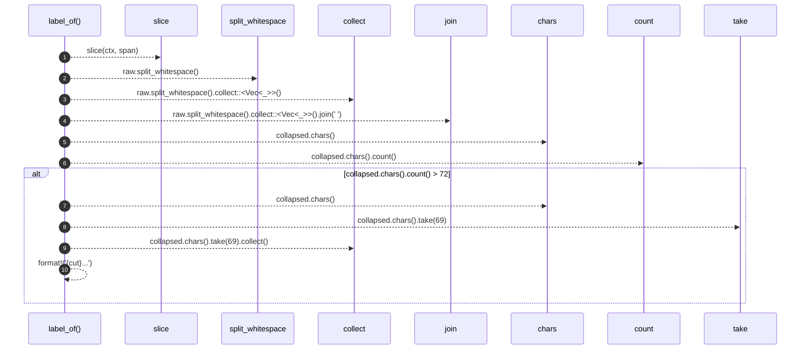

# `robby_extract::rust::label_of`

[Self-model](../../README.md) · [rust](index.md)

| | |
|---|---|
| kind | `code.function` |
| signature | `fn label_of(ctx: &Ctx<'_>, span: &Span) -> String` |
| location | [`crates/robby-extract/src/rust.rs:519`](../../../../crates/robby-extract/src/rust.rs#L519) |
| provenance | extractor · confidence 1.00 |

```rust
fn label_of(ctx: &Ctx<'_>, span: &Span) -> String {
    let raw = slice(ctx, span);
    let collapsed = raw.split_whitespace().collect::<Vec<_>>().join(" ");
    if collapsed.chars().count() > 72 {
        let cut: String = collapsed.chars().take(69).collect();
        format!("{cut}...")
    } else {
        collapsed
    }
}
```



10 steps · 0 observed · 10 possible only

**Edges**

- calls → [`robby_extract::rust::slice`](slice.md)
- calls → [`robby_render::view::select::collect`](../../robby_render/view/select/collect.md)
- calls → [`robby_render::view::select::collect`](../../robby_render/view/select/collect.md)

## References

- calls → [`robby_extract::rust`](index.md) — slice
- calls → [`robby_render::view::select`](../../robby_render/view/select/index.md) — collect

## Referenced by

- calls ← [`robby_extract::rust::walk_expr`](walk-expr.md)
- calls ← [`robby_extract::rust::walk_stmts`](walk-stmts.md)

