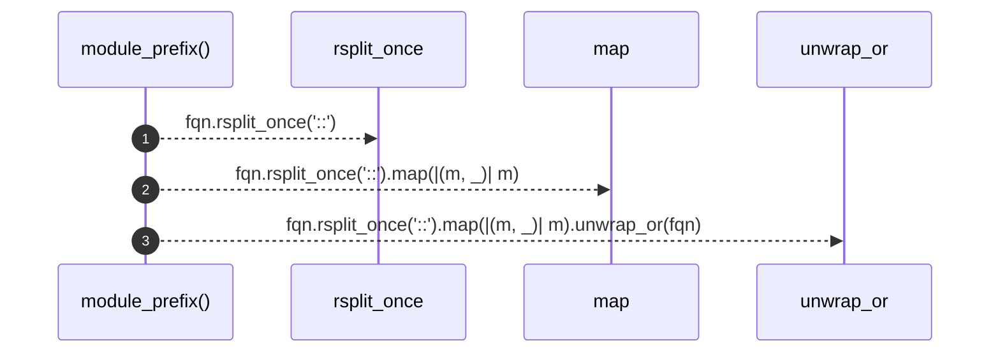

# `robby_extract::rust::module_prefix`

[Self-model](../../README.md) · [rust](index.md)

| | |
|---|---|
| kind | `code.function` |
| signature | `fn module_prefix(fqn: &str) -> &str` |
| location | [`crates/robby-extract/src/rust.rs:942`](../../../../crates/robby-extract/src/rust.rs#L942) |
| provenance | extractor · confidence 1.00 |

```rust
fn module_prefix(fqn: &str) -> &str {
    fqn.rsplit_once("::").map(|(m, _)| m).unwrap_or(fqn)
}
```



3 steps · 0 observed · 3 possible only

## Referenced by

- calls ← [`robby_extract::rust::pick_call_target`](pick-call-target.md)

