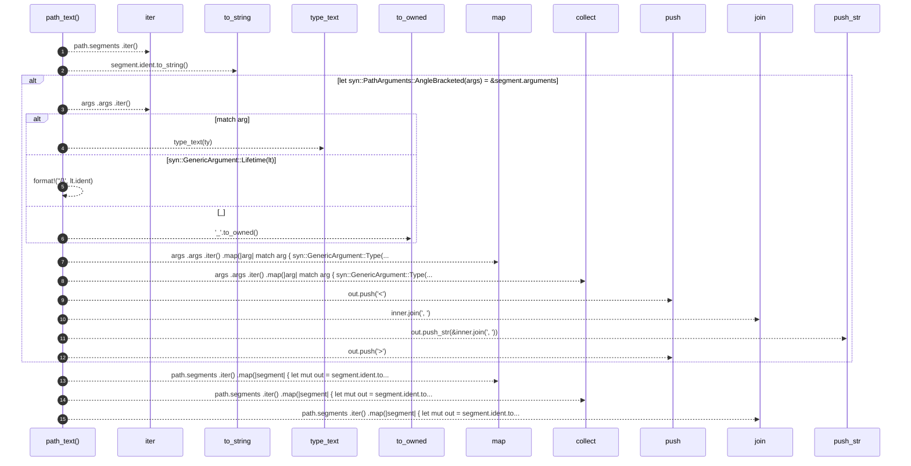

# `robby_extract::rust::path_text`

[Self-model](../../README.md) · [rust](index.md)

| | |
|---|---|
| kind | `code.function` |
| signature | `fn path_text(path: &syn::Path) -> String` |
| location | [`crates/robby-extract/src/rust.rs:410`](../../../../crates/robby-extract/src/rust.rs#L410) |
| provenance | extractor · confidence 1.00 |

```rust
fn path_text(path: &syn::Path) -> String {
    path.segments
        .iter()
        .map(|segment| {
            let mut out = segment.ident.to_string();
            if let syn::PathArguments::AngleBracketed(args) = &segment.arguments {
                let inner: Vec<String> = args
                    .args
                    .iter()
                    .map(|arg| match arg {
                        syn::GenericArgument::Type(ty) => type_text(ty),
                        syn::GenericArgument::Lifetime(lt) => format!("'{}", lt.ident),
                        _ => "_".to_owned(),
                    })
                    .collect();
                out.push('<');
                out.push_str(&inner.join(", "));
                out.push('>');
            }
            out
        })
        .collect::<Vec<_>>()
        .join("::")
}
```



15 steps · 0 observed · 15 possible only

**Edges**

- calls → [`robby_extract::rust::type_text`](type-text.md)
- calls → [`robby_render::view::select::collect`](../../robby_render/view/select/collect.md)
- calls → [`robby_render::report::impl Report::push`](../../robby_render/report/index.md)
- calls → [`robby_render::report::impl Report::push`](../../robby_render/report/index.md)
- calls → [`robby_render::view::select::collect`](../../robby_render/view/select/collect.md)

## References

- calls → [`robby_extract::rust`](index.md) — type_text
- calls → [`robby_render::report`](../../robby_render/report/index.md) — push
- calls → [`robby_render::view::select`](../../robby_render/view/select/index.md) — collect

## Referenced by

- calls ← [`robby_extract::rust::callee_display`](callee-display.md)
- calls ← [`robby_extract::rust::type_text`](type-text.md)

