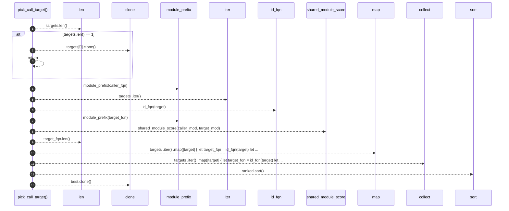

# `robby_extract::rust::pick_call_target`

[Self-model](../../README.md) · [rust](index.md)

| | |
|---|---|
| kind | `code.function` |
| signature | `fn pick_call_target(caller_fqn: &str, targets: &[NodeId]) -> (NodeId, f32)` |
| location | [`crates/robby-extract/src/rust.rs:902`](../../../../crates/robby-extract/src/rust.rs#L902) |
| provenance | extractor · confidence 1.00 |

> Prefer the callee in the same module as the caller; then longest shared
> module prefix; then shortest FQN (sibling over nested crate paths).

```rust
/// Prefer the callee in the same module as the caller; then longest shared
/// module prefix; then shortest FQN (sibling over nested crate paths).
fn pick_call_target(caller_fqn: &str, targets: &[NodeId]) -> (NodeId, f32) {
    if targets.len() == 1 {
        return (targets[0].clone(), 1.0);
    }
    let caller_mod = module_prefix(caller_fqn);
    let mut ranked: Vec<(i32, i32, usize, &NodeId)> = targets
        .iter()
        .map(|target| {
            let target_fqn = id_fqn(target);
            let target_mod = module_prefix(target_fqn);
            let exact = if target_mod == caller_mod { 1 } else { 0 };
            let shared = shared_module_score(caller_mod, target_mod) as i32;
            // Shorter FQN wins ties (crate::run over crate::nested::run).
            let len = target_fqn.len();
            (-exact, -shared, len, target)
        })
        .collect();
    ranked.sort();
    let best = ranked[0].3;
    let exact = ranked[0].0 == -1;
    let shared = -ranked[0].1;
    let confidence = if exact {
        0.95
    } else if shared > 0 {
        0.7
    } else {
        0.4
    };
    (best.clone(), confidence)
}
```



13 steps · 0 observed · 13 possible only

**Edges**

- calls → [`robby_extract::rust::module_prefix`](module-prefix.md)
- calls → [`robby_extract::rust::id_fqn`](id-fqn.md)
- calls → [`robby_extract::rust::module_prefix`](module-prefix.md)
- calls → [`robby_extract::rust::shared_module_score`](shared-module-score.md)
- calls → [`robby_render::view::select::collect`](../../robby_render/view/select/collect.md)

## References

- calls → [`robby_extract::rust`](index.md) — id_fqn, module_prefix, shared_module_score
- calls → [`robby_render::view::select`](../../robby_render/view/select/index.md) — collect

## Referenced by

- calls ← [`robby_extract::rust::pick_call_prefers_same_module`](tests/pick-call-prefers-same-module.md)
- calls ← [`robby_extract::rust::resolve_calls`](resolve-calls.md)

