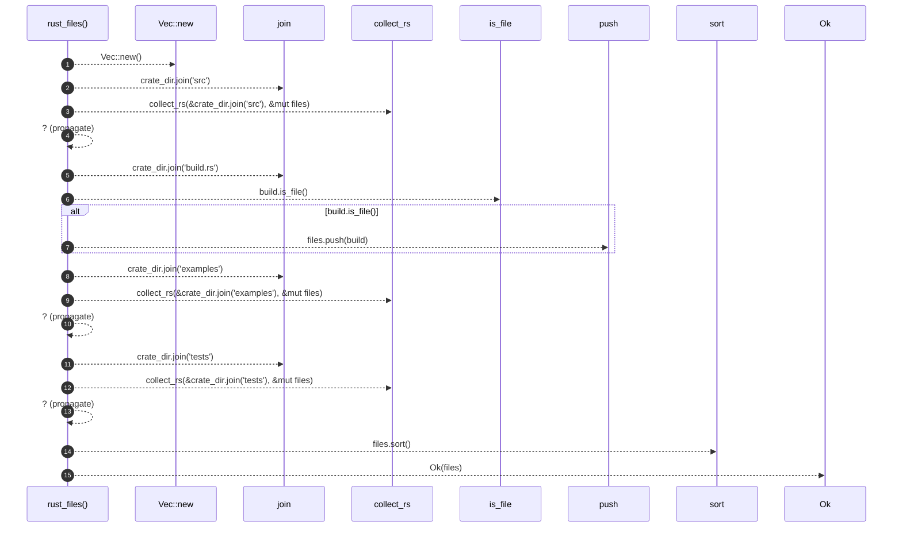

# `robby_extract::rust::rust_files`

[Self-model](../../README.md) · [rust](index.md)

| | |
|---|---|
| kind | `code.function` |
| signature | `fn rust_files(crate_dir: &Path) -> Result<Vec<PathBuf>>` |
| location | [`crates/robby-extract/src/rust.rs:72`](../../../../crates/robby-extract/src/rust.rs#L72) |
| provenance | extractor · confidence 1.00 |

```rust
fn rust_files(crate_dir: &Path) -> Result<Vec<PathBuf>> {
    let mut files = Vec::new();
    collect_rs(&crate_dir.join("src"), &mut files)?;
    let build = crate_dir.join("build.rs");
    if build.is_file() {
        files.push(build);
    }
    collect_rs(&crate_dir.join("examples"), &mut files)?;
    collect_rs(&crate_dir.join("tests"), &mut files)?;
    files.sort();
    Ok(files)
}
```



15 steps · 0 observed · 15 possible only

**Edges**

- calls → [`robby_extract::rust::impl LineIndex::new`](index.md)
- calls → [`robby_extract::rust::collect_rs`](collect-rs.md)
- calls → [`robby_render::report::impl Report::push`](../../robby_render/report/index.md)
- calls → [`robby_extract::rust::collect_rs`](collect-rs.md)
- calls → [`robby_extract::rust::collect_rs`](collect-rs.md)

## References

- calls → [`robby_extract::rust`](index.md) — collect_rs, new
- calls → [`robby_render::report`](../../robby_render/report/index.md) — push

## Referenced by

- calls ← [`robby_extract::rust::discover_crates`](discover-crates.md)

