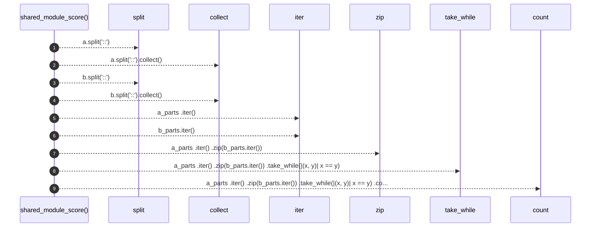

# `robby_extract::rust::shared_module_score`

[Self-model](../../README.md) · [rust](index.md)

| | |
|---|---|
| kind | `code.function` |
| signature | `fn shared_module_score(a: &str, b: &str) -> usize` |
| location | [`crates/robby-extract/src/rust.rs:951`](../../../../crates/robby-extract/src/rust.rs#L951) |
| provenance | extractor · confidence 1.00 |

```rust
fn shared_module_score(a: &str, b: &str) -> usize {
    let a_parts: Vec<&str> = a.split("::").collect();
    let b_parts: Vec<&str> = b.split("::").collect();
    a_parts
        .iter()
        .zip(b_parts.iter())
        .take_while(|(x, y)| x == y)
        .count()
}
```



9 steps · 0 observed · 9 possible only

**Edges**

- calls → [`robby_render::view::select::collect`](../../robby_render/view/select/collect.md)
- calls → [`robby_render::view::select::collect`](../../robby_render/view/select/collect.md)

## References

- calls → [`robby_render::view::select`](../../robby_render/view/select/index.md) — collect

## Referenced by

- calls ← [`robby_extract::rust::pick_call_target`](pick-call-target.md)

