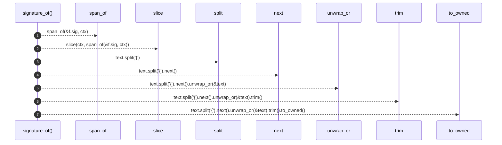

# `robby_extract::rust::signature_of`

[Self-model](../../README.md) · [rust](index.md)

| | |
|---|---|
| kind | `code.function` |
| signature | `fn signature_of(f: &syn::ItemFn, ctx: &Ctx<'_>) -> String` |
| location | [`crates/robby-extract/src/rust.rs:379`](../../../../crates/robby-extract/src/rust.rs#L379) |
| provenance | extractor · confidence 1.00 |

```rust
fn signature_of(f: &syn::ItemFn, ctx: &Ctx<'_>) -> String {
    let text = slice(ctx, span_of(&f.sig, ctx));
    text.split('{').next().unwrap_or(&text).trim().to_owned()
}
```



7 steps · 0 observed · 7 possible only

**Edges**

- calls → [`robby_extract::rust::span_of`](span-of.md)
- calls → [`robby_extract::rust::slice`](slice.md)

## References

- calls → [`robby_extract::rust`](index.md) — slice, span_of

## Referenced by

- calls ← [`robby_extract::rust::walk_items`](walk-items.md)

