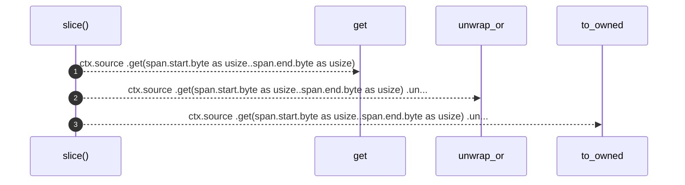

# `robby_extract::rust::slice`

[Self-model](../../README.md) · [rust](index.md)

| | |
|---|---|
| kind | `code.function` |
| signature | `fn slice(ctx: &Ctx<'_>, span: &Span) -> String` |
| location | [`crates/robby-extract/src/rust.rs:512`](../../../../crates/robby-extract/src/rust.rs#L512) |
| provenance | extractor · confidence 1.00 |

```rust
fn slice(ctx: &Ctx<'_>, span: &Span) -> String {
    ctx.source
        .get(span.start.byte as usize..span.end.byte as usize)
        .unwrap_or("")
        .to_owned()
}
```



3 steps · 0 observed · 3 possible only

**Edges**

- calls → [`robby_ir::model::impl Document::get`](../../robby_ir/model/index.md)

## References

- calls → [`robby_ir::model`](../../robby_ir/model/index.md) — get

## Referenced by

- calls ← [`robby_extract::rust::label_of`](label-of.md)
- calls ← [`robby_extract::rust::signature_of`](signature-of.md)

