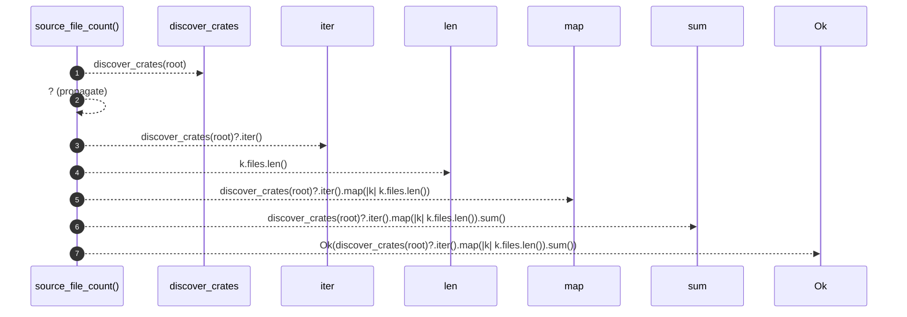

# `robby_extract::rust::source_file_count`

[Self-model](../../README.md) · [rust](index.md)

| | |
|---|---|
| kind | `code.function` |
| signature | `fn source_file_count(root: &Path) -> Result<usize>` |
| location | [`crates/robby-extract/src/rust.rs:956`](../../../../crates/robby-extract/src/rust.rs#L956) |
| provenance | extractor · confidence 1.00 |

> Count of `.rs` files the extractor considers part of the workspace.

```rust
/// Count of `.rs` files the extractor considers part of the workspace.
pub(crate) fn source_file_count(root: &Path) -> Result<usize> {
    Ok(discover_crates(root)?.iter().map(|k| k.files.len()).sum())
}
```



7 steps · 0 observed · 7 possible only

**Edges**

- calls → [`robby_extract::rust::discover_crates`](discover-crates.md)

## References

- calls → [`robby_extract::rust`](index.md) — discover_crates

