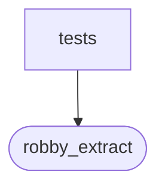

# `robby_extract::rust::tests`

[Self-model](../../../README.md) · [rust](../index.md)

| | |
|---|---|
| kind | `code.module` |
| declared at | [`crates/robby-extract/src/rust.rs:966`](../../../../../crates/robby-extract/src/rust.rs#L966) |
| provenance | extractor · confidence 1.00 |
| nodes | 4 |

## Package diagram

## Dependency matrix

| | tests | robby_extract |
|---|---:|---:|
| **tests** | · | 4 |
| **robby_extract** | | · |
## References

- calls → [`robby_extract::rust`](../index.md) — byte, new, pick_call_target

## Items

| Item | Kind | Steps | Location |
|---|---|---:|---|
| [`pick_call_prefers_same_module`](pick-call-prefers-same-module.md) | `code.function` | 4 | `crates/robby-extract/src/rust.rs:970:5` |
| [`line_index_handles_non_ascii`](line-index-handles-non-ascii.md) | `code.function` | 5 | `crates/robby-extract/src/rust.rs:982:5` |

## Imports

- `use super::*;`

