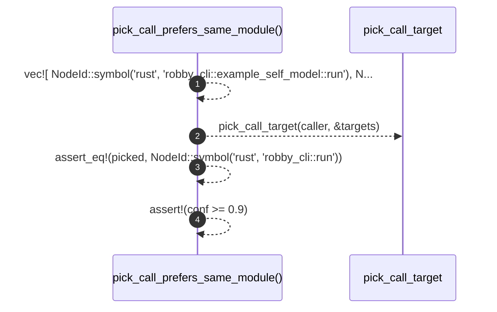

# `robby_extract::rust::pick_call_prefers_same_module`

[Self-model](../../../README.md) · [rust::tests](index.md)

| | |
|---|---|
| kind | `code.function` |
| signature | `fn pick_call_prefers_same_module()` |
| location | [`crates/robby-extract/src/rust.rs:970`](../../../../../crates/robby-extract/src/rust.rs#L970) |
| provenance | extractor · confidence 1.00 |

```rust
#[test]
    fn pick_call_prefers_same_module() {
        let caller = "robby_cli::main";
        let targets = vec![
            NodeId::symbol("rust", "robby_cli::example_self_model::run"),
            NodeId::symbol("rust", "robby_cli::run"),
        ];
        let (picked, conf) = pick_call_target(caller, &targets);
        assert_eq!(picked, NodeId::symbol("rust", "robby_cli::run"));
        assert!(conf >= 0.9);
    }
```



4 steps · 0 observed · 4 possible only

**Edges**

- calls → [`robby_extract::rust::pick_call_target`](../pick-call-target.md)

## References

- calls → [`robby_extract::rust`](../index.md) — pick_call_target

